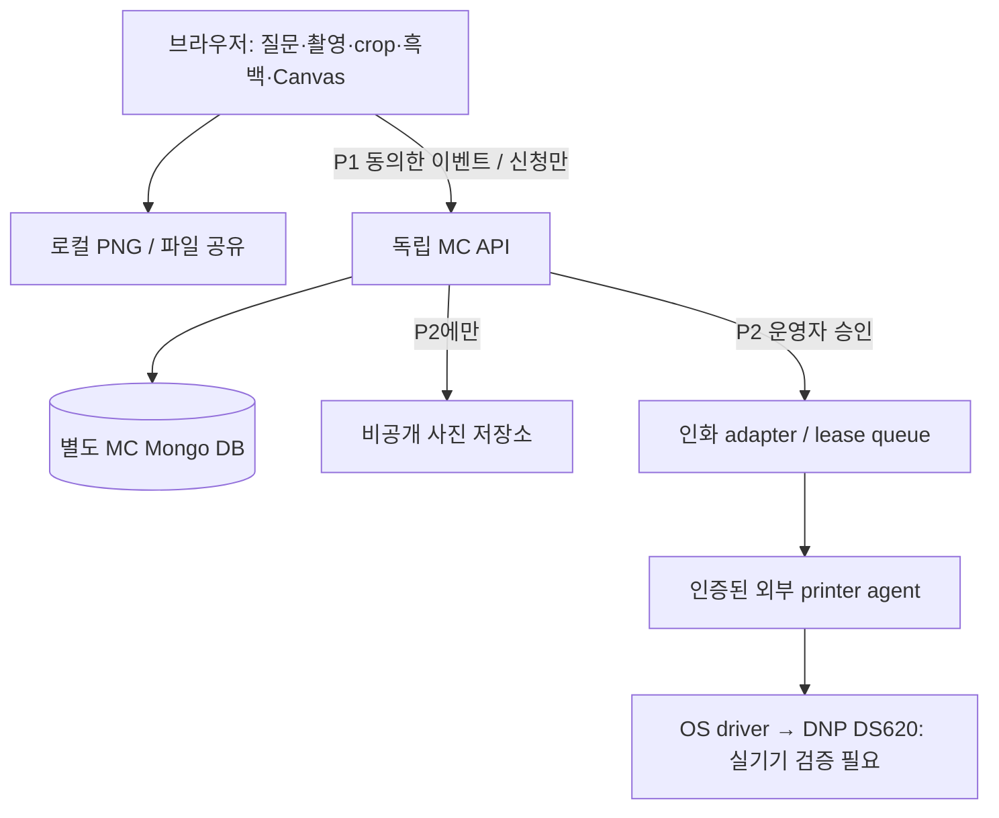

# Missed Connections — 기술·데이터·API 설계

버전 1.0 · 2026-10-30 · **제안 설계: 아래 모델/API는 현재 구현되어 있지 않다.** 기존 사실은 [REPOSITORY_AUDIT](REPOSITORY_AUDIT.md), 제품 규칙은 [PRD](PRD.md)가 기준이다. 이번 작업은 신규 코드·설정·마이그레이션을 실행하지 않는다.

## 1. 구조 결정

**독립 배포 가능한 Next.js 앱 + 별도 Mongo DB + 로컬 사진 처리**를 권장한다. 기존 서버를 fork 하더라도 전체 페이지를 복제하지 않고 검증한 순수 유틸리티를 선별 이식한다. 광고용 P1은 인화·결제·공개 Blob·실제 매칭에 의존하지 않는다.

| 결정 | 근거 / 영향 |
|---|---|
| 독립 host와 root layout | 기존 [root layout](../../app/layout.tsx)과 [slug layout](../../app/[slug]/layout.tsx)에 브랜드·AuthProvider·기존 GA가 결합됨. nested `/mc`만 추가하면 분리 보장 안 됨 |
| 독립 DB 접근 모듈 | [mongodb.ts](../../lib/mongodb.ts)의 DB 명이 `photoast`로 고정. 연결 URI의 DB 명만 바꿔도 격리되지 않음 |
| P1 사진·퀴즈 로컬 | [merge API](../../app/api/layouts/merge/route.ts)는 업로드까지 수행하며 [blob.ts](../../lib/blob.ts)는 public 저장. 매칭 서비스의 비공개 사진 요구에 부적합 |
| 인증 새 경계 | 기존 [admin login](../../app/api/auth/login/route.ts)과 [middleware](../../lib/middleware.ts)의 literal cookie 검사는 재사용 금지 |
| 인화는 P2 adapter | [print API](../../app/api/print/route.ts)는 결제·기존 event·여러 printer mode와 결합. 내부 변환·보정 함수만 재사용 후보 |
| P1 별도 계정 로그인 없음 | 로컬 체험은 서버 로그인 없이 가능. 신청 시 소유 receipt 세션, P2는 행사 체크인 기반 participant 세션 |

후속 개발 구조 제안(이번에는 디렉터리 생성 안 함): 별도 저장소 `missed-connections`가 가장 단순하다. 동일 저장소를 유지한다면 `apps/missed-connections/` 독립 앱·독립 lockfile/배포 root를 사용하되 기존 root 앱의 패키지/tsconfig를 재구성하지 않는다. 공유 라이브러리 추출은 회귀 검증 후 별도 이슈로 진행한다. monorepo 도구 도입은 전제 조건이 아니다.

```text
apps/missed-connections/       # 향후 별도 repo root로 옮겨도 같은 경계
  app/(experience)/            # 8개 화면, 독립 root layout/metadata
  app/api/mc/v1/               # 아래 신규 REST API
  components/{quiz,camera,crop,strip,waitlist}/
  domain/{quiz,matching,consent}/
  lib/{canvas,session,db,analytics,private-assets,print-adapter}/
  public/brand/                # 독립 로고·OG·frame descriptor
```



현재 Vercel Production 배포 이력은 확인했지만 새 서비스의 배포 계정·도메인·Mongo transaction 지원·private storage·자동 삭제 scheduler·이메일 비용은 미확인이다. 외부 서비스 생성/호출·유료 구독을 이번 문서로 승인하지 않는다. 무료 한도와 비용 상한을 별도 확인 후 구현 환경을 정한다.

## 2. 클라이언트 상태와 재사용 경계

| 모듈 | 재사용 근거 | 신규 책임 |
|---|---|---|
| camera controller | [CameraCapture](../../app/components/CameraCapture.tsx), [booth capture loop](../../app/[slug]/booth/page.tsx) | 전면 기본, explicit gesture, background/rotation 중단, late stream stop, timer cancel token. 기존 언어/이벤트/60초 reset 결합 제거 |
| crop editor | [FourCutCropEditor](../../app/components/FourCutCropEditor.tsx), [useSlotPhotoCrop](../../app/components/useSlotPhotoCrop.tsx) | 4개 원본 Blob과 슬롯별 crop/zoom/rotation, 키보드 zoom, EXIF 방향/HEIC 실패 안내. 업로드 호출 제외 |
| renderer | [renderLayoutPreviewCanvas](../../lib/boothSamples.ts), [types](../../lib/types.ts) | 600×1800 신규 4슬롯 descriptor, 픽셀 흑백, font-ready, PNG Blob, export와 preview 동일 crop. 같은 파일의 업로드 helper 호출 금지 |
| camera sound | [boothCaptureSound](../../lib/boothCaptureSound.ts) | 기본 off, 사용자 켜기, 취소/숨김 때 silence |
| save/share | [keepsake page](../../app/keepsake/[token]/page.tsx) | Blob 미리 준비 → 사용자 click에서 즉시 Web Share; await fetch 뒤 transient activation 유실 방지 |
| image conversion | [기존 메인](../../app/[slug]/page.tsx), [process-image](../../app/api/process-image/route.ts) | 로컬 HEIC 동적 변환만 선별. P1은 server process-image 호출 안 함 |
| print | [image-correction](../../lib/image-correction.ts), [print](../../app/api/print/route.ts), [agent jobs](../../app/api/printer-client/jobs/route.ts) | 신규 권한·동의 wrapper, private fetch, idempotency, atomic claim, 작업 불명 처리 |

클라이언트 flow state는 `landing → onboarding → quiz → capture → reveal → strip → waitlist → success`. step guard는 현재 답변/사진 준비 상태를 검사한다. 뒤로 가기로 입력을 잃지 않으며 quiz 수정은 derived profile/strip을 무효화한다. `flowId`는 난수이며 인증 수단이 아니다.

- `sessionStorage`: 질문 버전·답변·동의 UI 상태·마지막 step, 2시간 TTL. 민감한 P2 선호·연락처·사진·서버 인증 토큰 저장 금지.
- 메모리: 원본 Blob, crop metadata, PNG, 입력 중 이메일. object URL은 교체/종료 시 revoke. refresh 때 사진 유실 안내.
- P1 개선의 opt-in IndexedDB: 기기 공유 위험 고지, 2시간 만료 검사+명시적 삭제. 닫힌 브라우저의 정시 삭제를 보장하지 않음.
- 클라이언트 score는 P1 본인 설명에만 사용. P2는 서버가 versioned Answer 로 재계산하며 클라이언트가 보낸 score를 신뢰하지 않는다.
- 카메라: HTTPS·`playsInline muted`·권한 거부/장치 없음/사용 중/대기 취소 분기. 촬영은 단일 sequence ID 로 이전 타이머의 늦은 콜백 차단. 저장은 `document.fonts.ready`와 이미지 decode 완료 후 수행한다.
- 파일 입력: 최대4개, 각10MB/40MP, MIME 뿐 아니라 decode 결과 검사. HEIC 변환 전 크기 제한, 실패하면 JPG 선택. 브라우저 메모리 피크는 원본 크기에 영향받으므로 큰 입력은 순차 decode/downsample·해제한다. 해당 상한은 실제 iPad/iPhone QA 로 낮출 수 있다.

P2 참가 인증은 운영자가 발급한 단일 사용 등록 토큰을 서버에서 검증한 뒤 참가자 전용 세션으로 교환한다. `authSubject`는 이 등록 레코드의 불투명 ID이며 클라이언트 입력값이 아니다. 토큰 소지와 현장 성인 확인은 별개이고, 체크인 전에는 매칭·타인 사진에 접근할 수 없다. 키오스크 QR를 쓸 때는 짧은 유효기간·한 번 사용·회차 종료 초기화를 적용한다.

## 3. 데이터 모델

공통: UUID/불투명 ID, UTC ISO timestamp, `schemaVersion`, 서버가 생성한 `createdAt/updatedAt`, 필요 시 `expiresAt/deletedAt`. 클라이언트 전달 field는 allowlist, Mongo `_id`를 인증으로 사용하지 않는다. 아래 collection은 모두 신규 MC DB에 만 있다. P0에서 만들 필요 없는 collection은 P2까지 생성하지 않는다.

| 모델 / 단계 | 필드와 관계 | 제약·보관 |
|---|---|---|
| **Event** / P2 (P0 캠페인은 정적 config 가능) | id, slug, title, timezone=`Asia/Seoul`, start/end, venue 공개 안내, status=draft/open/running/closed/cancelled, capacity, minAge=19, questionVersion, matchingPolicyVersion, frameVersion, printerBindingId | slug unique; end>start; 정원/정책 변경 audit; 개인정보 없는 행사 설정과 참가 데이터 보관 분리 |
| **Participant** / P2 | id,eventId,nickname,ageYearsAtEvent(현장 확인),adultVerifiedAt,checkInAt,status,preferences{ageMin,ageMax,allowedGenderValues},selfDeclaredGender(필요 시만),preferenceVersion,blockedParticipantIds,contactEncrypted(optional),authSubject | unique(eventId,authSubject); age 범위19~99 제안; 나이 원본 생일/신분증 저장 안 함. 연령은 행사일 기준 서버 확인. end+30일 삭제 |
| **Question** / P0 정적 JSON, P2 서버 snapshot | id,version,text,scale[1..5],axis,reverse,itemWeight,order,active | unique(version,id), 각버전 정확히12개·ID 고정, publish 후 immutable; 문구는 PRD §6 원본 |
| **Answer** / P1 로컬, P2 저장 | participantId,questionVersion,questionId,value(1..5 정수),revision,answeredAt | unique(participantId,questionVersion,questionId); 12개 atomic replace; 혼합 버전/누락 계산 금지; end+30일 |
| **PhotoSession** / P1 로컬 객체, P2 저장 | id,eventId,participantId,status=draft/ready/uploaded/deleting/deleted,shotCount=4,shots[{assetId,crop,rotation}],frameVersion,filterVersion,renderVersion,stripAssetId,uploadConsentVersion | owner만 접근, shots4개/회전0·90·180·270/crop bounds 검사, 원본·파생 asset registry; P2 end+7일 |
| **Match** / P2 | id,eventId,roundId,participantIds(정렬된2명),pairKey,questionVersion,policyVersion,scoreInternal,sharedTopics,status=offered/mutual/closed/expired/revoked,expiresAt,revision | pairKey=hash(eventId,sortedIDs) unique 로 행사 내 재제안 금지; active slot 별 unique guard 추가. score 응답 기본 제외, end+30일 |
| **MatchConsent** / P2 | id,matchId,participantId,purpose=photo_reveal/partner_print_download/contact_exchange,decision=allow/revoke,version,policyVersion,decidedAt | append-only 결정 이력 + 현재 projection unique(matchId,participantId,purpose). 이전 allow 로 새 match 허용 안 함. participant 서비스·업로드 동의는 별도 ConsentRecord |
| **WaitlistApplication** / P0 | id,campaignId,emailEncrypted,emailLookupHmac,region,priceBand,adultAttestedAt,requiredConsentVersion,marketingOptIn,marketingConsentVersion(optional),receiptOwnerSessionId,attribution(optional),status,expiresAt | unique(campaignId,emailLookupHmac); trim/domain lowercase, local-part 임의 dot/plus 제거 안 함; 신규 전환1회; 신청+90일 또는 철회 |
| **AnalyticsEvent** / P0 선택 동의 | eventId,name,occurredAt,receivedAt,anonymousSessionId,flowId,screen,mode,release,consentVersion,allowlistedProperties,attribution(optional),expiresAt | unique(eventId); raw30일; 사진·이메일·raw 답·선호·score 금지. 상세 계약은 ANALYTICS_SPEC |

보조 모델: `AnonymousSession`(opaque token hash, role, expiry), `ConsentRecord`(scope/version/withdrawal), `Asset`(owner/path/purpose/expiry/consent), `MatchRound`(draft/approved/committed+revision), `ActiveMatchSlot`(unique(eventId,participantId)), `MatchReaction`(unique(matchId,participantId)), `PrintJob/PrintAttempt`, `IdempotencyRecord`, `DeletionRequest/DeletionLedger`, `AuditLog`. 예시명이며 기존 `events/printJobs/userEvents`에 섞지 않는다.

**가격 enum**: `free_only`, `up_to_10000`(0원 초과~10,000원), `10001_to_20000`, `20001_to_30000`, `over_30000`, `undecided`. UI의 “1~2만원” 등에는 정확한 경계 보조설명을 넣어 중복을 없앤다. **지역 enum**: `gangnam_seocho`, `mapo_seodaemun`, `seongsu_konkuk`, `gangseo_magok`, `other_seoul`, `outside_seoul`. 지역/가격 각1개 필수이며 “모르겠어요” 가격은 유효 응답.

### P2 원자성·매칭 배치

PRD의 양방향 eligibility → 응답 유사도 → 최대 연결 인원/총점 → 대기 순서 규칙을 순수 함수로 분리한다. n≤30 행사 파일럿 정확해법 또는 검토된 solver, timeout 시 수동 검토. 이는 기존 코드에 없는 신규 개발이다.

1. round가 읽은 참가자/답변/선호/차단 snapshot 버전을 기록하고 관리자에게 후보/대기 사유를 dry-run 표시한다. 공개 전 score는 운영 진단용이다.
2. commit 시 Mongo transaction에서 round revision·모든 참가자의 최신 조건·block·active 상태 재검증. 양측 `ActiveMatchSlot`을 정렬 순서로 insert 하고 Match/pairKey와 outbox를 함께 기록한다.
3. unique 충돌/버전 변경은 전체 rollback, 409; 일부 사람에게만 제안 발송 금지. 알림은 commit 후 outbox 로 발행한다.
4. expire/decline/revoke 시 같은 transaction에서 상태 CAS(revision 비교)·slot 해제·asset 접근 차단. 두 사용자가 각각 새 제안을 요청해야 다음 round 대상이 된다. 이미 제안한 pair는 행사 내 재사용하지 않는다.
5. 사진 공개는 match 유효+양측 최신 photo allow+asset upload consent 유효 시에만. mutual like와 연락처 공개는 독립 계산. unknown/missing consent는 deny.
6. Mongo transaction 가능한 replica set/플랜은 미확인. 지원 안 되면 P2 출시 차단하고 설계를 재검토하며 단순 find→insert 로 대체하지 않는다.

## 4. REST 공통 계약

Base `/api/mc/v1`, same-origin HTTPS. 아래 `P0/P1/P2`는 [구현 계획](IMPLEMENTATION_PLAN.md) 우선순위다. GET no-store(비공개) / 정적 questions만 versioned cache. 예시 문자열은 샘플, 실제 사용자 데이터 아님.

- JSON 요청 최대32KB(analytics 별도64KB), Content-Type 검사; 미정의 field 거부, 길이·enum·날짜·형식 검증. 파일은 전용 업로드 경로만 사용.
- 성공: `{ "data": {...}, "requestId": "req_..." }`. 생성201, 조회/수정200, 삭제접수202, replay200. 명시된 public waitlist 응답은 신규·중복 모두 동일201로 예외 처리.
- 오류: `{ "error": { "code": "VALIDATION_ERROR", "message": "입력 내용을 확인해 주세요.", "fields": {"email":"형식을 확인해 주세요"}, "retryable":false }, "requestId":"req_..." }`. stack/쿼리/DB 키/PII 반환 금지.
- 400 malformed, 401 session required, 403 CSRF/role/consent, **404 소유권 없는 개인 자원도 동일**, 409 state/version/idempotency conflict, 410 expired owned flow, 413 size, 415 media, 422 semantic validation, 429 Retry-After, 503 dependency unavailable. 5xx는 서버 commit 여부 불명일 수 있어 동일 idempotency key 로만 재시도.
- mutation `Idempotency-Key` UUID, session+route+body hash 기준24시간 레코드; 동일 key/동일 body replay, 다른 body409. 세션 자체·analytics는 해당 token/eventId 로 중복 처리. waitlist 키는 새로고침 후 재시도를 위해 불투명 값만 sessionStorage에 보관.
- cookie는 새 MC host의 `__Host-mc_session` opaque256bit, HttpOnly/Secure/SameSite=Lax/Path=/, DB에 는 hash만. 소유 세션으로만 receipt 접근. P1 익명 세션 TTL2시간, 신청 receipt 관리 세션은90일까지 별도 명시적 cookie/삭제 접근 제공. Cookie는 다른 사람과 기기를 공유할 때 지우기 기능 제공.
- CSRF: same-origin Origin/Fetch-Metadata+서버 세션에 묶인 token, CORS wildcard 금지. 익명 세션 생성도 Origin 검증+rate limit. IP는 raw 장기 저장 없이 회전 HMAC bucket, 분산 rate store 지원 확인 필요.
- P1 로컬 퀴즈/촬영은 API 로그인에 의존하지 않는다. 신청/분석 선택 때만 서버 세션 생성. 서버 session 장애여도 local export 가능, 신청만 오류 표시.

### 4.1 Phase 1 필수 API

| 우선 / Method path | request | response / 검증 / 오류 |
|---|---|---|
| P0 `GET /config` | 없음 | 200 `{campaignId,mode:"demo",acceptingWaitlist,questionVersion,frameVersion,policyVersions,waitlistExpiresDays:90}`. 개인정보/기존 printer 설정 없음; 503이면 retry. mode를 query 로 live 전환 불가 |
| P0 `GET /questions?version=v1` | 허용 version | 200 `{version,items:[{id,text,axis,reverse,scale,order}]}` 정확히12개. 미발행 version404. P0 정적 bundled snapshot도 가능, 별도 DB CRUD 불필요 |
| P0 `POST /sessions` | `{adultAttested:true,servicePolicyVersion:"v1",analyticsConsent:false}` | 201 cookie+`{csrfToken,expiresAt,consentVersion}`; adultfalse422, stalepolicy409, rate429. self-attestation 이지 실명 성인인증 아님 |
| P0 `PUT /me/consents/analytics` | `{allowed:false,policyVersion:"v1"}` | 200 `{allowed,version}`; 미선택 기본 false, withdraw 이후 raw 신규전송 중단·로컬 미발송 queue 폐기. 최소한의 필수 동의 변경 원장은 analytics 이벤트와 분리 |
| P0 `POST /waitlist-applications` | 아래 예시 | 신규/동일 이메일 모두201 `{receiptRef,status:"received",region,priceBand,expiresAt}`. 이메일 존재 여부/created flag 노출 금지. 아래 중복 규칙 적용; 422/409/429/503 |
| P0 `GET /me/waitlist-application` | receipt owner cookie | 200 `{receiptRef,status,maskedEmail,region,priceBand,expiresAt}`; 다른 ID 로 조회 없음, 없으면404. UI success 새 방문을 전환으로 만들지 않음 |
| P0 `DELETE /me/waitlist-application` | CSRF + `{confirm:true}` | 202 `{deletionRequestId,status:"pending"}`; 즉시 마케팅/접근 차단, 소유 검증 실패404. 반복삭제 동일 응답 |
| P0 `GET /me/deletion-requests/:id` | 소유 cookie | 200 `{status:"pending\|completed",completedAt}`; 소유아니면404. 사진 object 삭제 없는 P1도 실제 이메일/파생 식별자 제거 확인 |
| P0 `POST /analytics/batch` | 동의한 session + 아래 분석 계약 | 202 `{acceptedEventIds:[...],duplicateEventIds:[...]}`; 미동의403, schema422, 초과413/429. 접수 장애로 체험 막지 않음 |

```json
{
  "campaignId": "seoul-pilot-v1",
  "email": "person@example.com",
  "region": "gangseo_magok",
  "priceBand": "10001_to_20000",
  "adultAttested": true,
  "privacyConsent": {"allowed":true,"policyVersion":"waitlist-v1"},
  "marketingConsent": {"allowed":false,"policyVersion":"marketing-v1"},
  "attribution": null
}
```

Waitlist의 durable DB write를 확인한 뒤에만201. 알림 발송 실패는 신청 실패와 분리한다. 기존 [saveLead](../../lib/leads.ts)의 오류를 삼키는 동작은 복제하지 않는다. **중복 개인정보 누출 방지**: 같은 owner의 재요청은 실제 기존 receipt replay. 다른 세션이 기존 이메일을 제출해도 동일한 불투명 “요청 접수” receipt를 발급하되 기존 신청의 contact/선택/동의를 읽거나 덮어쓰지 못한다. 그 세션의 GET에 는 제출한 선택과 마스킹 이메일만 응답한다. 기존 신청 변경·삭제는 원 소유 세션 또는 이메일 소유 확인 후 가능하다. 이 receipt는 신규 lead가 아니며 화면에 신규 등록/좌석 확보라고 표시하지 않는다. canonical lead unique insert 성공만 내부 전환으로 집계한다.

P0 세션을 잃은 삭제 요청은 공개된 개인정보 담당 접수 채널에서 이메일 소유 확인 후 처리한다. 현재 연결된 메일 공급자/주소는 미확정이며 **실제 운영 담당 접수 채널·응답 절차 게시가 P0 출시 조건**이다. 자동 `POST /waitlist-recovery` + `POST /waitlist-recovery/verify`(동일202 응답, single-use token hash/15분, rate limit)는 P1; 공급자·비용 확인 전 필수 의존으로 삼지 않는다. 검증 전 전체 이메일/접수 여부를 반환하지 않는다.

**P1에 만들지 않는 API**: raw answers/profile 업로드, 사진 upload/공개 결과 URL, 후보 찾기, like, 결제, print. config/question은 정적 제공 가능해 이 두 API를 과도한 관리 시스템으로 확장하지 않는다.

### 4.2 Phase 2 API — 우선순위 P2

모든 자원은 event scope + participant/operator 세션 검사. 각 요청에 requestId/오류 형식/CSRF/idempotency가 동일 적용된다. 리스트 pagination 최대50, IDOR는404.

| Method path | request → response | validation / 대표 오류 |
|---|---|---|
| `POST /events/:eventId/participants` | `{registrationToken,nickname,ageYearsAtEvent,serviceConsentVersion,preferences}` →201 `{participantId,status:"registered",revision}` | nickname2~20자, 나이19~99, 조건 양방향 대응 enum, 신청 토큰 단일사용; closed409/full409/underage422. 생일 원문 받지 않음 |
| `POST /events/:id/check-ins` (operator) | `{participantId,adultChecked:true,registrationToken}` →200 `{status:"checked_in"}` | 해당행사 operator, 신분증 사진 금지; token 재사용409/role403; 자가체크인만으로 성인 확인 확정 금지 |
| `PUT /me/preferences` | `{ageMin,ageMax,allowedGenderValues,expectedRevision}` →200 `{revision,effectiveRound:"next"}` | 19≤min≤max≤99; 조건 변경 중 진행 match 강제재배정 없음;409stale/422invalid; 민감정보 검토·동의 gate |
| `PUT /me/answers` | `{questionVersion,answers:[{questionId,value}],expectedRevision}` →200 `{completed:true,revision}` | ID 중복없음·정확12개·1~5정수·고정 version; 서버 재계산;422missing/409version. raw vector 응답 최소화 |
| `PUT /me/consents/photo-upload` | `{decision:"allow\|revoke",policyVersion}` →200 `{decision,consentVersion}` | 본인 참가 세션만. revoke 시 사진 접근·진행 중 사진 공개·인화 대기를 즉시 차단하고 삭제 worker 예약. 이미 출력된 종이는 회수 불가; 401/409/422 |
| `POST /me/photo-sessions` | `{frameVersion,filterVersion,shotCount:4,uploadConsentVersion}` →201 `{photoSessionId,assetUploadPolicy}` | 참가소유·사진 업로드 동의 필수; consent403/frame422. 서버 P2 asset lifecycle 시작 |
| `POST /me/photo-sessions/:id/assets` | multipart `{slotIndex,file,crop,rotation}` →201 `{assetId,width,height,status:"private"}` | 0..3, ≤10MB/40MP, decode/MIME allowlist·metadata 제거;413/415/422/404. 외부 URL·로컬 path 입력 불가 |
| `POST /me/photo-sessions/:id/finalize` | `{assetIds:[4],expectedRevision}` →200 `{status:"ready",stripAssetId}` | 본인 asset4개/정상 crop/font/frame, server 재합성·업로드동의 최신;409rev/422incomplete/503render |
| `GET /me/match` | 없음 →200 `{status:"waiting",reason:"candidate_unavailable"}` 또는 `{matchId,status,sharedTopics,canRevealPhoto,expiresAt,revision}` | 내부 score·상대의거절·raw 조건·URL 기본제외; waiting은200 empty-state, session401/expiredowned410 |
| `PUT /me/matches/:id/consents/:purpose` | `{decision:"allow\|revoke",policyVersion,expectedRevision}` →200 `{decision,consentVersion,canRevealPhoto}` | 본인현재 match·세 purposeallowlist, 철회 즉시재검증;403invalidpurpose/409state/404notowner |
| `GET /me/matches/:id/photo` | 없음 →200 비공개 이미지 proxy 또는 `{assetAccessUrl,expiresIn:60}` | 양측현행 allow+유효 match+업로드동의 필수;403notconsented/410revoked. proxy 권장, Cache-Control private,no-store |
| `PUT /me/matches/:id/reaction` | `{choice:"like\|pass",expectedRevision}` →200 `{myChoice,status:"offered\|mutual\|closed"}` | 타인의 단독 like 비공개, atomic mutual 결정;409expired/stale/404 |
| `GET /me/matches/:id/contact` | 없음 →200 `{contact:...}` | mutual+양측 contact_exchange allow 일때만;403/410. 연락처는 analytics/log에 넣지 않음 |
| `POST /me/match-requests` | `{nextRound:true}` →202 `{status:"waiting"}` | 이전활성없음, 종료 pair 재사용없음;409active. 상대의요청대신보내기금지 |
| `POST /me/blocks` / `POST /me/reports` | `{participantId,reasonCode,note?}` →201 `{reference,status:"received"}` | 동일행사접점확인, note≤500·사진첨부초기제외;422/429. block 즉시 active 정리·접근차단 |
| `POST /me/print-jobs` | `{photoSessionId,includePartner:false,sheets:1,expectedRevision}` →202 `{jobId,status:"PENDING",sheets:1,strips:2}` | event 허용 printer·본인자산·includePartner 시양측별도동의;403/409offline/422quantity. 클라 imageUrl/printerId/paymentTid 안 받음 |
| `GET /me/print-jobs/:id` | 없음 →200 `{status,sheets,strips,canRequestReview}` | 본인소유만404; UNKNOWN 이면 운영자확인 안내, 자동 재출력 금지 |
| `DELETE /me/data` | `{confirm:true}` →202 `{deletionRequestId,status:"pending"}` | 세션검증; 즉시참가중지·match/사진접근차단, 실제 object/agent 삭제후완료. 이미출력된종이회수불가안내 |

운영 API (모두 P2, 서버 RBAC+audit):

| Method path | request → response | 검증 / 오류 |
|---|---|---|
| `POST /admin/events` / `PATCH /admin/events/:id` | `{title,start,end,capacity,policyVersions,...,expectedRevision?}` →201/200 Event 요약 | owner 설정권한, interval/정원/정책 검증;403/409/422 |
| `GET /admin/events/:id/participants` | cursor/status →200 `{items,nextCursor}` | eventoperator 한정, 민감정보 기본마스킹;403/422 |
| `POST /admin/events/:id/match-rounds` | `{policyVersion,participantSnapshotRevision}` →201 `{roundId,status:"draft",pairs,waitingReasons,revision}` | dry-run 뿐; 서버 score, ≤30명제안,timeout503; 개인정보최소응답 |
| `POST /admin/match-rounds/:id/commit` | `{expectedRevision,approved:true}` →200 `{status:"committed",matchCount,waitingCount}` | 최신조건+DBtransaction+unique slots;409다시검토, dependency503 |
| `GET /admin/events/:id/print-jobs` | cursor/status →200 `{items,printerHealth}` | eventscope·privateassetURL 제외;403/422 |
| `POST /admin/print-jobs/:id/reprints` | `{reasonCode,physicalOutputChecked:true,sheets:1}` →202 `{attemptId,status:"PENDING"}` | UNKNOWN 실물 확인 필수·동의 재검사;409/403. 원래촬영/history 중복생성안함, 별도 PrintAttempt |
| `GET /admin/events/:id/metrics` | 기간 →200 집계 | eventscope, test jobs 분리, 소수 cell 억제;403/422 |

Agent API (P2 신규 보호 경계; 기존 `/api/printer-client` 무변경): `POST /agent/heartbeats {printerBindingId,ready,lastErrorCode}`→200 serverTime; `POST /agent/jobs/claim {printerBindingId}`→200 `{jobId,leaseToken,leaseExpiresAt,privateAssetUrl,paperSize:"4x6",sheets}` 또는204; `PATCH /agent/jobs/:id {leaseToken,status,attemptId,deviceEvidence?}`→200 최신작업. printer 별 rotation가 능 hashkey, 유효 binding/lease/허용상태 전이 확인; 401인증,404타 printer,409lease만 료/이미종료,422불가전이. 무제한 PENDING 목록을 가져오는 기존 방식은 중복 출력 방지를 위해 그대로 재사용하지 않는다.

## 5. 인화 adapter와 실패 모델

`request → 권한/동의 검사 → asset 검증 → 동일 2×6 strip 두 개를 4×6 용지에 배치 → image-correction → private spool → atomic queue → agent → driver`.

- [print API](../../app/api/print/route.ts)의 polling 분기와 [image-correction](../../lib/image-correction.ts)을 단위별 이식한다. HTTP self-call로 admin cookie를 우회하거나 기존 public upload/결제를 사용하지 않는다.
- DS620 전용 SDK/로컬 spooler는 repo에서 확인되지 않는다. 에이전트 소스·OS driver·USB/네트워크·2×6 cutter 설정 확보가 선행이다. 실장비 없이는 “연동 완료” AC를 통과할 수 없다.
- 용지1200×1800px(4×6@300dpi), 단일 strip600×1800이다. 회전/가장자리 보정은 실제 ruler test로 설정한다. PNG는 디지털 마스터이고 JPEG 변환은 printer adapter에서만 한다. sheets와 strips를 각각 기록한다.
- `PENDING→CLAIMED(lease)→PRINTING→DONE|FAILED|UNKNOWN`. claim 전 PENDING만 안전 취소한다. claim 후 전송 전 취소는 agent가 전송하지 않았다고 확인한 경우만 허용한다. driver 전송 후 통신 실패는 UNKNOWN으로 분류하고 실물을 확인한다. lease 만료만으로 자동 재출력하지 않는다.
- DONE은 장비 증거 수준을 함께 저장한다(`agent_ack|spooler_complete|device_confirmed|operator_confirmed`). 장비가 물리 완료를 보장하지 못하면 UI는 “프린터로 전송했어요”이며 실제 수령을 보장하지 않는다.
- heartbeat30초/stuck90초는 초기 제안이며 현장에서 조정한다. offline 상태에서 재전송 연타를 유도하지 않는다. 수동 재출력은 새 attempt·사유·idempotency를 기록한다.
- test mode는 별도 환경/명시적 배지로 구분하고 물리 출력 지표에서 제외한다. `SEND_PRINTER=false`는 기존 email 프린터에만 적용되어 전체 물리 출력 차단 스위치로 쓸 수 없다.

## 6. 보안·삭제·운영

- **타인 결과**: 모든 개인 조회는 server session→participant→event→resource owner 또는 현재 match consent 연결을 검사한다. UUID/짧은 토큰/QR는 권한 검사의 대체가 아니다. P2 operator는 행사 scope, owner/reviewer/agent 역할 분리·감사 로그·세션 회전/만료/원격 철회를 적용한다.
- **비공개 자산**: private bucket·추측 불가능 key·권한 검사 proxy/no-store가 기본이다. 60초 signed URL은 철회 전에 발행된 URL이 만료까지 남는 위험이 있으므로 즉시 철회가 필요하면 proxy를 우선한다. 원격 이미지 URL을 요청 본문으로 받아 fetch하지 않아 기존 SSRF/path 경로를 재현하지 않는다.
- **업로드**: signature/실제 decode/픽셀/바이트 제한, decompression bomb·SVG/HTML 차단, EXIF 위치 제거, JPEG/PNG 재인코딩을 적용한다. 본인 아닌 사진 업로드 금지 안내·신고 경로를 제공하며 자동 얼굴 신원 추론은 하지 않는다.
- **연락처**: application-level encryption 키 분리·이메일 lookup keyed HMAC·DB unique를 적용한다. HMAC도 개인정보일 수 있으므로 원본과 함께 삭제한다. 재신청 제한 해시를 몰래 영구 보관하지 않는다. secrets는 client bundle/log/analytics에 없다.
- **삭제 worker**: 즉시 접근 차단 → registry의 원본/파생/OG/스풀 삭제 → 답·선호·연락처·매칭 식별자·알림 대기열 제거 → analytics 연결 식별자 삭제 → backup 삭제 원장 기록. 부분 실패는 재시도·운영자 알림으로 처리하고 전체 확인 후 completed로 바꾼다. Mongo TTL는 object 삭제 worker를 대체할 수 없다.
- **보관**: P1 이메일90일/raw analytics30일/P2 사진event+7일/기타event+30일 등은 PRD 제안이다. scheduler 무료 한도/실행 주기는 미확인이다. 자동 삭제·보관 정책의 실동작을 출시 전에 검증한다.
- **로그**: requestId·정형 errorCode·단계·latency만 기록한다. Telegram 등 외부 알림에 이메일/사진/성별 조건/서명 URL/토큰을 보내지 않는다. 개인정보 없는 장애 집계만 설정된 운영 채널로 보낸다.
- **OG**: 일반 브랜드 그래픽·설명·canonical URL만 포함하고 user result/연락처는 없다. 행사 제목은 공개 승인된 이름만 사용한다.

## 7. 주요 기술적 위험과 검증

| 위험 | 출시 전 확인 |
|---|---|
| Safari 메모리/권한/앱내 브라우저 | iPhone+iPad 실기기, background/rotation/거부/HEIC/4컷 반복 후 camera indicator·메모리·PNG 확인 |
| renderer font/crop/색상 불일치 | 한글12문항·성향 문구 글리프, 모서리 crop, preview/export 픽셀 비교,600×1800 출력 |
| 광고 분석과 동의 | 동의 전 전송0건, 거부해도 서비스 완료, unknown 귀속 분리, 서버 전환 중복0건 |
| DB/저장소 격리 | MC 연결로 photoast 컬렉션 조회·수정0건, 기존 GA/결제/프린트 요청0건 |
| matching race | 동시 round commit/like/revoke 검증,1인 active≤1·차단 pair0·사진 유출0건 |
| DNP 외부 agent 미확인 | 소스/driver 확보 후 실물 출력·케이블 단절·용지 없음·중복 claim·UNKNOWN 수동 확인 |
| 비용/정책 | 도메인·DB·private storage·email·cron 무료 한도, Meta 정책·성인 타기팅·법무 검토. 확인 전 집행 안 함 |

브라우저 참고: [getUserMedia](https://developer.mozilla.org/en-US/docs/Web/API/MediaDevices/getUserMedia), [Web Share 명세](https://www.w3.org/TR/web-share/), [Safari video](https://developer.apple.com/documentation/webkit/delivering-video-content-for-safari). 지원을 문서로만 가정하지 말고 목표 실기기에서 검사한다.
