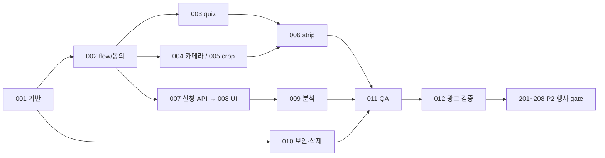

# Missed Connections — 구현 이슈·검증·출시 계획

버전 1.0 · 2026-10-30 · **이번 작업은 문서 작성만 수행한다. 아래 이슈는 후속 개발 작업이다.** [PRD](PRD.md) / [실사](REPOSITORY_AUDIT.md) / [설계](ARCHITECTURE.md) / [분석](ANALYTICS_SPEC.md).

## 1. 우선순위와 실행 규칙

- **P0**: Phase 1 광고 전에 필수. 독립 브랜딩·정직한 데모·로컬 사진·durable 신청·동의/삭제·Safari 검증을 묶어서 출시한다. 촬영만 되고 신청이 유실되는 버전은 광고하지 않는다.
- **P1**: 첫 검증 이후 개선. GIF·기기 draft·자동 이메일·콘텐츠 실험. P0에 억지로 추가해 초기 검증을 지연하지 않는다.
- **P2**: Phase 2 행사 전에 필수. 후순위라는 이유로 동의·보안·신고·실인화 검증 없이 실제 사람을 연결하지 않는다.
- 각 이슈의 완료는 코드 존재가 아니라 아래 테스트/AC 통과다. 현재는 어떤 신규 기능도 구현 완료로 체크하지 않는다.
- 패키지 설치·새 계정/도메인·유료 API·DB 변경·메일 발송·광고 집행은 이 문서 작성 범위가 아니다. 후속 구현은 서비스 비용/무료 한도와 실제 권한을 확인한다.

## 2. 브랜치와 영향 격리

현재 문서 branch는 `docs/missed-connections-prd`, 기준 `b6f26693c65a04fcf0c11e6f46fa4002e870fccc`. 이 branch는 아래 5개 문서만 추가하고 commit/push 한다. 기존 파일·설정·데이터·배포 환경은 변경하지 않는다.

후속 개발은 `feat/mc-phase1-foundation`에서 시작해 새 독립 저장소로 이식하거나 독립 `apps/missed-connections/`를 추가한다. 기존 root 앱을 workspace 로 변환하거나 `app/[slug]`의 route 처리·공통 layout·GA·printer mode를 바로 수정하지 않는다. route 대안을 쓰려면 격리 runtime을 reverse proxy 하는 방식으로 독립 root를 유지한다. 현재 프로젝트는 monorepo가 아니므로 디렉터리 추가만으로 독립 배포가 되는 것은 아니다.

기존 코드 선별 복사 시 출처 commit·함수 경계·기존 import 의존성을 기록하고, 카메라/Canvas/크롭의 필요한 부분만 새 어댑터 아래 사용한다. 공유 코드 추출로 기존 소비자까지 바뀌는 변경은 별도 PR과 회귀 테스트로 처리한다. 기존 부스의 60초 reset·결제·public 업로드·랜덤 sample을 신규 매칭 flow에 포함하지 않는다.

각 이슈는 별도 PR 가능한 범위로 나누고, dependencies가 완료되기 전에는 feature flag 로 미노출한다. 사용자에게 보이는 새 서비스 launch와 기존 PhotoToast 배포를 같은 완료 조건으로 묶지 않는다.

## 3. P0 — Phase 1 필수 이슈

### MC-001 — 독립 앱·브랜드·환경 경계

- **작업/신규**: 독립 root layout, 8개 화면 route skeleton, 디자인 tokens, env validation, demo 전용 config, 공개 metadata/OG, 별도 DB 접근 모듈 경계 정의. 도메인은 가용성·비용 확인 뒤 연결.
- **재사용**: [package.json](../../package.json)의 현재 Next/React/TS 조합을 출발점으로 평가. [layout](../../app/layout.tsx)은 구조 참고만, 기존 로고/GA/AuthProvider는 복제하지 않음.
- **의존성**: 없음. 별도 운영 주체·host·배포 계정 결정은 출시 gate.
- **테스트**: 320/390/768px route smoke, network audit, env 누락 fail-closed, 기존 앱 URL 회귀 smoke.
- **AC**: `/`부터 waitlist 까지 독립 브랜드; 기존 GA/결제/print/public upload 호출 0건; MC DB 로 photoast 컬렉션 접근0.
- **위험**: 현재 `mongodb.ts` DB 명 고정, nested route 상속, 광고 attribution 섞임. 독립 runtime으로 해결.

### MC-002 — 성인·동의·로컬 flow 복원

- **작업/신규**: Onboarding, 19세 자가확인, 필수/선택 동의 분리, flow guard, 뒤로/다시 시작, 2시간 versioned sessionStorage draft, 철회/로컬 삭제.
- **재사용**: 기존 촬영 화면의 상태 분기 아이디어만. 기존 `pt_device_id`와 admin cookie는 사용하지 않음.
- **의존성**: MC-001, 정책 문구 초안은 MC-010과 조율.
- **테스트**: 직접 route 진입·만료·버전 변경·분석 거부·storage 불가·뒤로 가기·새로고침.
- **AC**: 미성인 확인 진행 차단, 분석 거부해도 체험 가능, quiz 복원·사진 유실 안내, reset 시 Blob/답변 제거.
- **위험**: 자가확인을 법적 본인인증으로 과장, 공유 기기에 기록 잔류. 고지와 TTL·초기화로 제한.

### MC-003 — 12문항·정규화·본인 결과 엔진

- **작업/신규**: PRD Q01~12 정적 version, 5점 UI, reverse normalization, 6차원 profile, 고정 서술·관심사 tie 처리, Match Reveal DEMO.
- **재사용**: 없음(새 도메인). 랜덤 부스 sample 함수는 매칭으로 사용하지 않음.
- **의존성**: MC-001/002.
- **테스트**: reverse1→1/5→0, all3=.5, 결측/중복/혼합 version 거부; 예시 S=75·동일100·반대0은 향후 매칭 함수 공통 fixture. 수정 후 derived 결과 무효화.
- **AC**: 정확12개만 완료, 같은 답은 같은 결과, P1 pair score·가짜 상대0, raw 응답 network 전송0.
- **위험**: 비임상 질문의 타당성 과장. 유사도와 성공 확률 구분·질문 version 기록.

### MC-004 — Safari 카메라·4컷 촬영·피드백

- **작업/신규**: camera controller hook, explicit 전면 촬영, 3초 countdown×4, 1초 freeze, 컷별/전체 재촬영, sound toggle, background/회전 취소, 오류 안내.
- **재사용**: [CameraCapture](../../app/components/CameraCapture.tsx), [booth 촬영 loop](../../app/[slug]/booth/page.tsx), [boothCaptureSound](../../lib/boothCaptureSound.ts). upload/merge/60초 reset 로직 제외.
- **의존성**: MC-001/002. MC-005와 슬롯 descriptor 계약 공유.
- **테스트**: iPhone/iPad Safari 실기기, Chrome 보조; deny/busy/no device/late permission/background/rotation·중복클릭; 4컷10회 반복 후 stream 해제.
- **AC**: 4/4 검토 전 전이 불가; 한 컷 재촬영 나머지 보존; 숨김 중 셔터0; sound off 로도 촬영 인지; 사진 upload 요청0.
- **위험**: transient activation·탭 복귀·메모리, iOS/앱내브라우저 차이. Safari 열기/사진 선택 대안 필수.

### MC-005 — 사진 선택·슬롯 크롭·흑백 파이프라인

- **작업/신규**: JPG/PNG/WebP/HEIC 로컬 선택, 4개 제한·10MB/40MP 검사, EXIF 정규화·metadata 제거, 원본/crop/회전/zoom 저장, 실제 픽셀 흑백.
- **재사용**: [FourCutCropEditor](../../app/components/FourCutCropEditor.tsx), [useSlotPhotoCrop](../../app/components/useSlotPhotoCrop.tsx), [기존 HEIC 처리 참고](../../app/[slug]/page.tsx). prepared pool 업로드 제외.
- **의존성**: MC-001/002, descriptor는 MC-006과 합의.
- **테스트**: 얼굴이 가장자리에 있는 portrait/landscape, EXIF90도, 큰 HEIC·잘못된파일·GIF/SVG 거부, 키보드 zoom, 같은사진 반복교체 후 object URL 정리.
- **AC**: 권한 거부해도 파일4개로 끝까지 가능; crop 결과 preview/export 일치; 새로 crop 해도 원본 보존; 서버 자동 fallback 업로드0.
- **위험**: HEIC decoder 메모리·미지원, 확대 시 저해상도. 원인별 안내와 입력 상한·순차 처리.

### MC-006 — 프레임·PNG·공유·모바일 결과 뷰

- **작업/신규**: 새 NY 빈티지 4슬롯 frame descriptor, font-ready Canvas,600×1800 PNG, compact 확대뷰, 미리 생성 Blob 공유·다운로드·공유 fallback, DEMO 내장.
- **재사용**: [renderLayoutPreviewCanvas](../../lib/boothSamples.ts), [PrintSize/Slot](../../lib/types.ts), [keepsake share 참고](../../app/keepsake/[token]/page.tsx). `composeTestPreview`는 축소/업로드하므로 제외.
- **의존성**: MC-003/004/005; font 라이선스/글리프 확인.
- **테스트**: 한글 누락·font 지연·CORS taint·null Blob·share cancel/미지원, Safari 저장 sheet, 390×844/200% text, 실제 PNG 치수/4슬롯 경계.
- **AC**: crop/흑백/문구가 미리보기와 PNG에서 같음; DEMO 포함; 신청 없이 저장; share 취소로 결과 초기화0; 공개 사진 URL0.
- **위험**: await 뒤 share activation 소실, canvas 메모리·폰트 fallback. Blob 선생성·최종 decode gate.

### MC-007 — 신청 API·durable 저장·소유 영수증

- **작업/신규**: 익명 서버 session/CSRF, WaitlistApplication DB·unique HMAC·연락처 암호화, 신청/소유 receipt 조회, idempotency, 동일형태 중복 응답, 분산 rate limit·honeypot. 이메일/지역/가격·동의만 수집.
- **재사용**: Mongo driver 패턴만; [leads.ts](../../lib/leads.ts)의 B2B 필드·오류 swallowing·PII 알림·기존 [user-events](../../app/api/user-events/route.ts)의 무인가 API는 사용하지 않음.
- **의존성**: MC-001/002, 독립 DB/키 관리, MC-010 정책.
- **테스트**: double-click·동일 key retry·다른 body409·DB 단절·타 세션 기존 email·입력조작·CSRF·429·직접 successURL.
- **AC**: DB insert 미확인시 성공0; unique 신규1회; 중복으로 원 동의/선택 덮어쓰기0; 타인 receipt 조회0; 네트워크 실패 후 동일 key 로 안전 재시도.
- **위험**: duplicate email enumeration, 이메일 실제 소유 미검증, rate store 비용/지원. 같은 public 응답·개인정보 검토·후속 확인 절차.

### MC-008 — Waitlist·Success 화면과 운영 집계

- **작업/신규**: S7/S8 UI, 6권역/6가격 enum, 필수 동의·선택홍보, validation/focus/429, masked receipt, 참가 미확정 카피. 최소 운영 집계는 권한 있는 서버 조회/내보내기로 제공하고 공개 endpoint 금지.
- **재사용**: 기존 폼 스타일/브랜드는 가져오지 않음. Next form 컴포넌트 패턴만 참고.
- **의존성**: MC-007, MC-002.
- **테스트**: direct waitlist→성인확인, 키보드 viewport·뒤로·reload·서비스접수와메일전송상태 구분, 가격구간경계.
- **AC**: 신청 없이 체험 가능; 실패/중복/접수 성공 상태 정확; 신청 확인은 owner session; 실명·전화·생일·사진 필드0.
- **위험**: 사전예약을 확정 좌석으로 오해. 날짜·장소·가격 미정 및 무료 알림 신청 문구 CTA 옆 유지.

### MC-009 — 분석·UTM·광고 지표

- **작업/신규**: ANALYTICS_SPEC의 allowlist collector·batch·dedupe·동의 queue,7일 UTM 귀속, 이벤트 코호트 집계·운영 신청 대조, 독립 공개 OG.
- **재사용**: [gtag.ts](../../lib/gtag.ts) 기능 목록만 참고; 기존 GA ID·persistent device ID·user-events API 호출 금지.
- **의존성**: MC-001/002/007, MC-003~008 event hooks.
- **테스트**: A01~A10 전체, 동의 전  network0, event injection/PII 거부, retry 중복, 전체 신청과 동의퍼널 분모 분리.
- **AC**: mode=demo, raw 답/사진/이메일0, server insert만 신규 전환, 공유 시도/resolve/실게시 구분;unknown 귀속을 paid 로채우지않음.
- **위험**: 작은 표본·동의 편향·이벤트 유실. 표본수·unknown·미관측을 함께 보고.

### MC-010 — 개인정보·보안·삭제 운영

- **작업/신규**: 실제 처리방침/동의문구·담당 접수 채널, 소유권·CSRF·암호화·secret 검증, waitlist 삭제 API·삭제 worker·보관90일/analytics30일·실패재시도, 키 회전·비식별 장애로그.
- **재사용**: 기존 admin literal cookie/public blob/delete API 금지. 운영 장애 정형화 아이디어만 [booth log](../../app/api/booth/log/route.ts) 참고.
- **의존성**: MC-001/007/009. 법무·운영 주체와 실제 데이터 flow 확인.
- **테스트**: 타 세션 조회/삭제404, 동의 철회, 만료 clock test, 실제문서삭제·원장·backup 정책, 연락처가 log/Telegram/URL에 없는지 검사.
- **AC**: 삭제 요청 접근차단 즉시·완료는 실제삭제 확인 후; session 유실 시 검증된 운영 접수 경로 게시; 무료 체험이 선택 동의에 묶이지 않음.
- **위험**: 자동 TTL만 믿고 object/백업 잔존, 이메일 삭제와 abuse hash 보관 충돌. 목적·기간·예외를 실제 정책에 명시.

### MC-011 — 접근성·모바일·회귀·출시 검증

- **작업/신규**: 8화면 UI QA·실기기 matrix·사용자5명 관찰·서비스/광고 release checklist·지원 FAQ, 예상 실패 복구 설명.
- **재사용**: 기존 프로젝트의 stories는 화면 참고 자료일 뿐 자동 테스트 infra가 아님. 새 앱의 최소 unit/integration/E2E 체계는 후속 구현 때 선정.
- **의존성**: MC-001~010.
- **테스트**: §6 matrix와 PRD 화면별 AC, 200%텍스트/VoiceOver/44px/대비/키보드/reduced-motion; 기존 부스·admin·print API read-only smoke, 실제출력요청은 제외.
- **AC**: 미해결 P0 blocker0·예상하지않은기존 코드 변경0; 기존 브랜드 호출0·P1사진서버전송0; 사용자5명 모두 DEMO와 신청미확정 의미 이해.
- **위험**: simulator만 통과·real Safari 미검증. 실기기 없으면 광고 launch 보류.

### MC-012 — 10만원 광고 실험 준비·판독

- **작업/신규**: 카피/포토스트립 두 소재, 광고 적격성·성인 타기팅 확인, UTMs/지출수동대조표, 내부10세션→10,000원 smoke→남은90,000원, 인터뷰질문/판독 보고서.
- **재사용**: MC-006의 본인 허락된 데모 이미지. 기존 고객 웨딩 사진/참가자사진 광고 전용으로 전용하지 않음.
- **의존성**: MC-011, 정책·비용·광고 계정 확인 및 실제 집행 승인.
- **테스트**: 모든 광고 링크·consent·event·DB 신청정합, 실제광고 분류/심사확인.
- **AC**: 총액≤100,000원·자동증액없음; ≥100landed/≥10신규 여부와 표본 부족 표시; 시장성과 아닌 가설 비교·6~10명 인터뷰 계획.
- **위험**: Meta 만남서비스 제한·작은표본·가격의향과구매혼동. 심사 우회 금지·부족표본추가예산별도결정.

## 4. P1 — 검증 이후 개선 이슈

### MC-101 — 선택적 기기 draft와 고해상도

- **작업**: opt-in IndexedDB 사진2시간, 초기화·만료·공유기기 경고;1200×3600 출력옵션은 메모리검사 후 제공.
- **재사용/신규**: 기존 object URL cleanup 패턴; IndexedDB repository·만료관리 신규.
- **의존성**: MC-005/006/010, 실제 refresh 이탈 근거.
- **테스트/AC**: 재진입 만료데이터삭제, opt-out 저장0, 닫힌브라우저정시삭제보장문구없음, 작은기기에서600pxfallback. 위험=디스크잔존·quota·OOM.

### MC-102 — 파일 공유용 GIF와 간격 조절

- **작업**: 본인4컷을 애니메이션으로, 간격300/500/800/1000ms·미리보기·다운로드·취소, DEMO 유지. 자동재생은 reduce-motion 고려.
- **재사용/신규**: 기존 [keepsakeGif.ts](../../lib/keepsakeGif.ts)와 [keepsakeGif.worker.ts](../../lib/keepsakeGif.worker.ts)의 인코딩·취소·자원 해제 재사용. 현재 입력 URL 기반 함수에 로컬 Blob 어댑터를 추가해야 한다. GIF는 P0 의존 아님.
- **의존성**: MC-006/011, 새 브랜드에서 GIF 수요 확인.
- **테스트/AC**: 파일 frame 수/간격/duration, 작업취소·메모리정리, 업로드0, 실패해도 PNG가 능. 위험=인코딩메모리·라이브러리종속·모바일파일공유 미지원.

### MC-103 — 이메일 소유 확인·자동 알림·신청 관리

- **작업**: 회복 single-use15분 token, 선택적확인메일·bounce·rate limit, 캠페인 contact 관리·철회 자동화. 발송비용/전달률 확인 후 도입.
- **재사용/신규**: [nodemailer 사용 참고](../../lib/email-printer.ts)는 기술만 참고, printer 이메일내용/수신자·PII 알림은사용안함. template·recovery·outbox 신규.
- **의존성**: MC-007/010, 공급자/무료상한/운영키 확인.
- **테스트/AC**: 미등록/등록 동일 응답,tokenhash·만료·한번사용,메일실패가신청을 rollback 하지않음,원 소유검증없이삭제/수정0. 위험=존재 여부노출·메일비용·스팸.

## 5. P2 — 실제 행사 필수 이슈

### MC-201 — 행사·참가·현장 체크인·역할 인증

- **작업**: Event/Participant·등록토큰·operator 체크인·성인 확인 기록·행사별 RBAC·private session·기기 초기화.
- **재사용**: [models.ts](../../lib/models.ts)의 Mongo CRUD 개념만. NextAuth 외부 provider를 필요 없이 의존하지 않음; 기존 admin auth 금지.
- **의존성**: P0 완료·법무/행사장/스태프·독립 DB.
- **테스트/AC**: 타 event 접근404/권한403,토큰재사용409,19세미만차단,신분증 이미지0,operator 최소권한. 위험=현장신원확인·공유 iPad 세션잔류.

### MC-202 — 선호·답변·매칭 순수 엔진과 dry-run

- **작업**: reciprocal hard filters, versioned score, 1:1 전역배치·대기사유·관리자 dry-run, policy threshold60/≤30명제안검증.
- **재사용**: MC-003 normalization fixtures. 기존 랜덤사진합성은 관계없음.
- **의존성**: MC-201, 민감선호 처리 법무 gate·참가 동의.
- **테스트/AC**: 홀수·후보 0·양방향불일치·차단·기제안 pair·동점·누락; brute-force 작은그래프와최대연결/총점비교;timeout은 대기. 위험=greedy 최적오해·조건희소성·편향.

### MC-203 — 원자적 예약·대기·만료·재신청

- **작업**: round snapshot/commit, ActiveMatchSlot unique+transaction,10분 offered expiry, decline/철회정리·새제안쌍방요청·outbox.
- **재사용**: 기존 printqueue 구조는 참고만, find→insert는 복사금지.
- **의존성**: MC-202, transaction 지원 replica set 실확인.
- **테스트/AC**: 동시 commit100회/조건중간변경/worker 재실행,1인 active≤1·pair 중복0·알림부분발송0. 위험=지원플랜미확인·race. 미지원시출시차단.

### MC-204 — 비공개 사진·목적별 동의·쌍방 호감

- **작업**: private asset registry/upload·서버 crop/BW·PhotoSession, MatchConsent/Reaction·공개 proxy·연락처별도동의·철회.
- **재사용**: [merge renderer](../../app/api/layouts/merge/route.ts)의 Sharp 변환만, [blob.ts](../../lib/blob.ts)의 public 저장/임의 URLfetch는 사용금지.
- **의존성**: MC-201/203, private storage·민감정보정책·MC-205삭제.
- **테스트/AC**: 한쪽 allow 로타인 URL0,양쪽 allow+현재 match만,철회즉시403/no-store,contact 동의별도,업로드 MIME/bomb/SSRF 차단. 위험=cache/signedURL 철회지연·스크린샷회수불가.

### MC-205 — P2 삭제·신고·차단·사고 대응

- **작업**: event+7일사진/event+30일관련정보 worker, asset/spool/backup 삭제원장, 신고 큐·staff escalation·피해자안내·행사중단.
- **재사용**: MC-010 삭제 orchestration 확장; 기존 Mongo TTL만 으로파일삭제안함.
- **의존성**: MC-201/204, 운영 담당자·권한·보관예외법무확인.
- **테스트/AC**: 상대 공개 즉시 철회·기제안 차단 pair 재사용0,object/파생/임시스풀실삭제,부분 실패 재시도·허위 완료0,종이회수불가고지. 위험=외부 agent 잔존·백업복원.

### MC-206 — 프린터 adapter·lease queue·운영 재출력

- **작업**: MC photoSession 기반출력 API,2×6복제4×6용지·보정,atomicclaim·device 별인증·상태 전이·UNKNOWN 수동확인·재출력 PrintAttempt·test 분리.
- **재사용**: [print polling 준비](../../app/api/print/route.ts), [image-correction](../../lib/image-correction.ts), [agent API](../../app/api/printer-client/jobs/route.ts). 결제/공개 이미지/기존 adminliteralcookie 제외.
- **의존성**: MC-201/204/205, 외부 agent 소스·DS620driver·실장비확보.
- **테스트/AC**: 실제1sheet=동일 strip2매,두 agent 동시 claim 중복0,전송후단절 UNKNOWN·자동 재출력0,타인 사진출력동의검사,기존 촬영 history 중복0. 위험=driverACK와 실물완료차이·용지/커터설정.

### MC-207 — 행사 운영·매칭/출력 분석 화면

- **작업**: event dashboard·waiting·dry-run/approve·동의상태·만남안내·printer health·재출력/신고/삭제큐, 운영매뉴얼.
- **재사용**: 기존 [admin](../../app/admin) 작업흐름 참고만, 새 RBAC/UI·MC 전용집계 신규.
- **의존성**: MC-201~206, ANALYTICS_SPEC P2.
- **테스트/AC**: eventscope·마스킹·소수 cell·test 제외·호감단독비공개;등록/참가/제안/쌍방/인화각각정의. 위험=민감정보과노출·출력횟수와촬영수혼동.

### MC-208 — 파일럿 리허설과 Go/No-go

- **작업**: staff 포함전체시나리오,≤30명파일럿운영가설검증·대기/거절/철회/비상중단·기기·전원·네트워크·사람동선·물리인화점검.
- **재사용**: MC-011 QA matrix·기존부스현장경험, 신규안전매뉴얼.
- **의존성**: MC-201~207 모두완료,장소/정원/가격정책확정·동의/법무/운영 gate.
- **테스트/AC**: 후보 0에서도본인 strip,연락처 강제0,실장비실물 확인,중복 출력/타인 접근0,실패시스태프도움경로. blocker 하나면행사매칭 기능 No-go. 위험=인력부족·참가균형·야외전원/우천.

## 6. 테스트 매트릭스와 공통 완료 기준

| 영역 | 최소 검증 | 근거/의미 |
|---|---|---|
| 순수 domain | normalization·reverse·tie·invalid·matching adversarial fixtures | 사용자에게다른성향/금지 pair를 제시하지않음 |
| API integration | DB 단절·unique/idempotency·session/CSRF/IDOR·삭제·consent | 성공허위·타인 노출·중복전환방지 |
| 브라우저 E2E | 8화면 happy path/뒤로/복원/권한거부업로드/PNG/신청 실패 | 로컬완료와서버접수분리 |
| Safari 실기기 | iPhone390×844근접기기+iPadPro12.9, 최신지원버전·가능하면이전주버전 | 실제버전기록;시뮬레이터로대체불가 |
| 기타브라우저 | AndroidChrome·desktopChrome·인스타앱내브라우저 | 앱내미지원시 Safari/기본브라우저전환안내 |
| 접근성 | VoiceOver·키보드·44px·200%·대비·reduced-motion | 사진/모션/색만으로정보전달안함 |
| 리소스 | 4컷10회·큰파일·중단·타이머/stream/objectURL 정리 | OOM/카메라가 계속 켜지는 현상 방지 |
| 보안/개인정보 | PII 없는 로그/분석·네트워크촬영업로드0(P1)·실삭제 | 문구와실제처리일치 |
| 실인화(P2) | DS6201sheet2strips·offline·단절·중복 claim·manualretry | ACK만 으로출력 성공단정안함 |
| 기존서비스회귀 | 변경범위검사·기존화면 read-onlysmoke·공유유틸변경시회귀 | 신규독립서비스가기존결제/촬영/출력에영향0 |

문서-only 작업인 **현재는 앱 build/test/DB 연결/실인화를 실행할 필요가 없다**. 문서 링크·파일 경로·명세 정합성·변경 파일 범위만 검사한다. 후속 구현에서는 위 표의 실제 테스트 결과·기기 버전·미해결 위험을 release record에 첨부한다. 기존 패키지에 테스트러너가 정의되어 있지 않으므로 테스트 명령이 이미 있다고 가정하지 않는다.

## 7. 의존성·규모 가늠

계획용 추정(보장 일정 아님): 기존코드를아는1인 engineer+필요시디자인/운영검토, P0총12~20 engineering days, P1선택기능각2~4일, P2추가15~30일. 법무·광고승인·DS620agent 확보·실기기/현장운영대기는포함하지않는다. 1차 P0완료후실측으로재산정한다. 우선질문없이문서기본값을정했지만외부비용/법률/물리출력의미확인 사항을완료로간주하지않는다.

## 8. 후속 착수 전 확인할 미확정 사항

- 독립 도메인/상표, 운영자 연락처·개인정보처리자, 실제 배포 계정·무료 한도·DB 지역·transaction·삭제 scheduler.
- GIF는 기존 URL 기반 입력을 로컬 Blob 입력으로 바꿨을 때의 메모리·공유 동작을 실기기에서 재검증한다. 현재 helper는 2~20장·너비240/360/480px·간격200~3000ms 검증이 있다. GIF는 광고 MVP의 선행 조건이 아니다.
- DS620 agent 위치·실행 OS·driver·커터 설정·상태보고 수준. 저장소에전용 driver가 있다고가정하지않음.
- Meta 만남서비스 광고 정책·심사/타기팅 조건, 성인 확인·선호정보·사진제공/인화 동의 법무검토.
- 행사일정/정원/스태프/참가비·우천/취소·안내동선. 현재 서비스는 무료 관심 신청이지 참가 확정/결제 예약이 아님.
