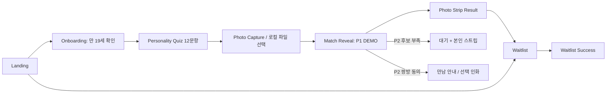

# Missed Connections — 제품 요구사항

문서 버전 1.0 · 2026-10-30 · 상태: 구현 전 제안 · 코드 기준 `b6f2669`.

이 문서는 실행 승인·시장 성과 보고서가 아니다. 현재 구현 확인은 [저장소 실사](REPOSITORY_AUDIT.md), 데이터/API는 [아키텍처](ARCHITECTURE.md), 이슈는 [구현 계획](IMPLEMENTATION_PLAN.md), 이벤트/지표는 [분석 명세](ANALYTICS_SPEC.md)를 기준으로 한다. 이번 산출물은 문서뿐이다.

## 1. 제품 정의와 성공 조건

**Missed Connections**는 오프라인에서 처음 보는 사람이 부담 없이 대화를 시작하도록, 성향 탐색과 아날로그 사진을 매개로 연결하는 독립 서비스다.

> 어쩌면, 우리가 만났어야 할 이유.

핵심 경험: **12문항 → 나의 네 장 → 대화 성향/매칭 상태 → 포토스트립 → 선택한 실제 만남**.

가설: “소개팅 앱의 공개 프로필 탐색보다, 짧은 자기 탐색과 촬영이라는 활동이 첫 만남 참여 의사를 높인다.” 기술 재사용은 방법이며, 사진만 예쁜 생성기나 검증되지 않은 궁합 판정기가 목표는 아니다.

- 1차 고객 가설: 서울 오프라인 소규모 행사에 관심 있는 만 19세 이상 성인. 광고 첫 타깃 가설은 서울 생활권 25~34세, 성별 제한 없이 시작한다. 데이터로 변경한다.
- 해결할 일: 자기소개 부담 완화, 자연스러운 첫 대화 소재, 행사 후 간직할 사진.
- Phase 1 성공: 유효한 파일럿 관심 신청과 지역/가격 수요를 측정. 서로 만난 커플 수를 측정했다고 주장하지 않는다.
- Phase 2 성공: 상호 동의한 후보 연결·선택한 만남·물리 인화가 안전하게 작동. 연락처 제공이나 실제 대화는 강제하지 않는다.
- 비목표: AI 얼굴/매력 평가, 연애 성공 확률, 실시간 채팅, 무한 스와이프, 미성년 참가, 가상 인물, 소득·종교·정치·건강·주민번호 수집, 실제 상대 없는 “매칭 완료” 연출.

## 2. 단계와 출시 범위

| | Phase 1 — 광고 검증 웹 | Phase 2 — 실제 오프라인 |
|---|---|---|
| 결과의 의미 | 본인 성향 요약 + 명시적 DEMO | 해당 행사 체크인 참가자 중 조건에 맞는 1:1 후보 |
| 사진 | 로컬 4컷, 촬영 또는 기기 파일 선택 | 로컬 검토 후 별도 업로드 동의, 비공개 저장 |
| 상대 표시 | 없음. 글·추상 빈 프레임만, 가짜 얼굴/일치율 없음 | 공개 수락한 사진만 해당 후보에게 제한 공개 |
| 포토스트립 | 본인 사진 + DEMO 라벨, PNG 저장/공유 | 기본 본인 사진, 쌍방 별도 동의 때만 상대 포함 |
| 신청 | 이메일 1개·희망 지역·지불 의향, 결제 없음 | 참가 등록·체크인·선호 조건·선택적 연락처 교환 |
| 운영 | waitlist 집계·광고 유입 분석 | 후보 부족 대기·쌍방 호감·만남 안내·인화·신고/차단 |
| 데이터 | 퀴즈/사진 로컬; 신청과 동의한 익명 퍼널만 서버 | 참가/동의/매칭/작업을 별도 DB에 보관 |

P0=Phase 1 유료 광고 전 필수. P1=초기 데이터 이후 개선. P2=Phase 2 행사 파일럿 필수. P2라고 안전·동의 기능을 미뤄도 행사를 열 수 있다는 뜻은 아니다.

사전예약이라는 표현은 **서울 파일럿 참가 알림 신청**으로 명확화한다. 날짜·장소·가격 미확정, 자리 보장/결제 예약 아님을 CTA 옆에서 알린다. 일정이 확정되지 않은 가짜 마감·잔여 좌석·참여자 수를 표시하지 않는다.

## 3. 브랜드와 화면 원칙

뉴욕 빈티지 포토부스의 좁은 포토스트립, 흑백 사진, 티켓 번호·날짜 인쇄감을 활용한다. 미스터리는 상대의 정체를 꾸며내는 대신 “아직 정해지지 않은 만남”의 여백으로 표현한다.

- 색: 잉크 `#181818`, 종이 `#F5F1E9`, 보조 잉크 `#58534C`, 단일 벽돌색 `#783E32`(작은 강조/오류). 최종 대비 측정 후 고정. 과한 핑크·하트·그라데이션·웨딩 세이지는 사용하지 않는다.
- 서체: 이미 있는 Noto Sans KR 계열을 본문 후보로 사용하되 `lib/fonts/NotoSansKR-Subset.ttf`의 12문항 전체 글리프를 검사한다. 영문 제목은 system serif 후보. 새 폰트는 추후 라이선스/한글 포함 확인 후 선택한다. 폰트 로딩 완료 전 최종 PNG 생성 금지.
- 390×844: 가로 20px 여백, 콘텐츠 350px, 상단 높이 56px, CTA 터치 높이 52px. 본문 16px 이상, 보조 라벨 13px 이상, 44×44px 터치 영역, safe-area 반영. CTA는 키보드가 열리면 자연 스크롤 가능.
- 320px: 가로 오버플로 없이 설문 선택지는 세로 배치. 768px 이상: 중앙 모바일 컬럼 480px; 촬영/결과만 2컬럼 가능. 태블릿에서 과도하게 화면을 확대하지 않는다.
- 모션: 결과 인쇄 슬라이드 250~400ms, 필수 대기 시간 없음. reduced-motion은 즉시 전환. 셔터 소리 기본 꺼짐/명시적 켜기, 시각·텍스트 피드백 함께 제공.
- 신규 root layout은 PhotoToast 로고·favicon·메타·GA·SNS 카드·결제 문구·기존 고객 로그인/알림을 상속하지 않는다. 독립 host 권장, 경로 실험도 격리된 runtime의 `/mc`로만 제공한다.

## 4. 전체 여정·세션 규칙

공통 세션: `flowId`는 난수, 도메인 분리. step/답변/questionVersion은 sessionStorage에 2시간 만료로 저장. 성인 확인 완료 전 설문/촬영 진입 금지. 직접 URL 진입 시 첫 누락 단계로 redirect. 브라우저 뒤로 가기는 답변을 유지하며 history state로 동작한다. 퀴즈 답을 바꾸면 결과·점수·스트립을 invalidation한다. 사진을 바꾸면 스트립만 재생성한다.

사진은 기본 메모리 Blob. 뒤로 이동은 같은 탭 메모리에서 유지하지만 **새로고침 후 사진은 복원되지 않음을 촬영 화면에 고지**한다. 복귀 시 답변은 복원하고 “사진을 다시 준비해 주세요”로 안내. P1 개선에서만 별도 “이 기기에 2시간 임시 보관” 선택과 IndexedDB+명시적 지우기를 제공한다. `URL.createObjectURL` 값 자체를 영구 저장하지 않는다. 키오스크는 사진 임시 저장 선택 금지·회차 종료/운영자 초기화 시 전체 비움.

네트워크가 끊겨도 이미 로드된 테스트/합성/PNG 저장은 가능해야 한다. 이는 최초 로딩/완전 오프라인 PWA 보장이 아니다. waitlist 서버 접수는 온라인 재시도. 결과 확인과 저장은 신청 없이 가능하다.

## 5. 화면별 명세

아래 Analytics ID는 [ANALYTICS_SPEC](ANALYTICS_SPEC.md)의 계약을 사용한다. 공통 접근성은 의미 있는 h1, label/fieldset, 키보드, 초점 이동, 오류 연결, 색상 외 상태 표현, 200% 텍스트 확대다.

### S1. Landing

- **목적**: 3초 안에 “성인 대상 오프라인 만남을 준비하는 촬영 체험”임을 이해하고 시작/관심 신청 선택.
- **카피**: `Missed Connections` / `어쩌면, 우리가 만났어야 할 이유.` / `12개의 질문과 네 장의 사진으로, 나의 대화 방식을 발견해 보세요.` / `지금은 체험 버전입니다. 실제 상대와 연결되지 않아요.`
- **구성**: 브랜드+짧은 카피, 라이선스 확보한 자사 모델 흑백 스트립 또는 비식별 그래픽(“연출 이미지” 라벨), 3단계 설명, 성인/개인정보 요약, FAQ. 얼굴 있는 가짜 참가자 사례 금지.
- **CTA/전이**: `내 성향과 네 컷 만들기`→S2. 보조 `서울 파일럿 소식 받기`→S7, 동일 성인 gate 적용. 서비스 설명/개인정보 링크는 새 창+복귀 유지.
- **상태**: 이미지 lazy-load 실패 시 종이 프레임 fallback; config 503 시 `잠시 후 다시 열어 주세요`+재시도, 기존 캐시 버전 있으면 명시적 사용. 모집 중단이면 체험 가능/신청 중단 구분.
- **뒤로/복원**: 진행 중 세션 있으면 `이어서 만들기`와 `새로 시작`(로컬 삭제 확인). 유입 UTM은 CTA 이동으로 덮어쓰지 않음.
- **접근성/반응형**: 설명을 이미지 안에만 넣지 않음. 390×844에서 DEMO 고지와 primary CTA 첫 viewport 안에 위치. 자동 동영상·오디오 없음.
- **이벤트**: `mc_landing_view`, `mc_start_click`, `mc_waitlist_open`.
- **AC-L1**: 광고 링크 첫 진입에 브랜드/체험 고지/CTA 노출. **AC-L2**: 추적 거부/카메라 미지원에도 랜딩과 신청 작동. **AC-L3**: 기존 브랜드/기존 GA 요청 0건.

### S2. Onboarding

- **목적**: 참가 대상·체험 한계·사진 처리 방식을 이해한 뒤 명시적으로 시작.
- **카피**: `지금은 나를 알아보는 체험이에요.` / `실제 만남은 추후 서울 파일럿에서 진행합니다.` / `촬영 사진은 기본적으로 이 기기에서만 처리해요.`
- **구성**: 12문항→4컷→본인 스트립 안내, unchecked `만 19세 이상입니다` 필수, 서비스 이용 동의(필수), 선택적 비식별 이용 분석 동의와 자세히 보기. 사전예약 개인정보 동의는 S7에서 별도로 받음.
- **CTA/전이**: `동의하고 시작`→S3. 필수 미선택 시 해당 항목으로 초점. 카메라 권한은 아직 요청하지 않음. `대상이 아니에요`→내용 보존 없이 랜딩 종료 안내.
- **상태**: 동의 문서 버전 로딩 실패 시 진행 금지+재시도. 서버 인증 실패를 온라인 체험 중단으로 잘못 처리하지 않음.
- **뒤로/복원**: 성인 확인을 저장하되 device age verification이라고 표기하지 않음. 2시간/새 회차/정책 변경 시 재확인.
- **접근성/반응형**: checkbox label 전체 클릭 44px, 필수/선택 글자로 구분, 긴 약관은 접이식 요약+전체 문서. 작은 화면 sticky CTA가 약관을 가리지 않음.
- **이벤트**: `mc_onboarding_view`, `mc_onboarding_complete`, `mc_age_gate_exit`, `mc_analytics_consent_update`.
- **AC-O1**: 만 19세 미확인은 테스트 진입 불가. **AC-O2**: 분석 동의 거부만으로 차단 안 됨. **AC-O3**: 성인 자가확인과 현장 신분 확인을 구분 표시.

### S3. Personality Quiz

- **목적**: 12개 응답으로 자기 대화·생활 선호를 탐색.
- **카피**: `정답은 없어요. 요즘의 나에 가까운 쪽을 골라 주세요.` / `3 / 12` / `답을 바꿔도 괜찮아요.`
- **구성**: 상단 뒤로+진행, 문항 한 개, 1~5 라디오 선택지(전혀 아니다~매우 그렇다), 이전/다음. 자동 다음으로 넘어가지 않는다.
- **전이**: `다음 질문`은 현재 응답 뒤 활성; 12번 `네 컷 찍으러 가기`→S4. 종료/모두 초기화는 확인.
- **상태**: 질문 버전 없으면 오류; 11개 응답/중복 ID/알 수 없는 문항은 점수 생성 불가. 응답 누락은 inline 안내. 로컬 저장 실패여도 메모리 진행 가능+복원 제한 고지.
- **뒤로/복원**: 각 선택 즉시 draft, 뒤로 가기/새로고침 시 버전·2시간 TTL 일치하면 복원. 버전 변경 시 변경 문항을 재응답, 다른 버전 혼합 점수 금지.
- **접근성/반응형**: fieldset/legend/radiogroup, 선택 시 텍스트/테두리 변경. 390px에서는 5개 세로 44px 이상, 화면리더에 진행 상황 안내.
- **이벤트**: `mc_quiz_started`, `mc_question_view`, `mc_question_answered`(questionId만), `mc_quiz_completed`, `mc_quiz_abandoned`는 heartbeat 대신 세션 종료 후 집계로 추론.
- **AC-Q1**: 12개 유효 답변만 완료. **AC-Q2**: 이전 답 수정 후 결과가 재계산됨. **AC-Q3**: raw 답/성향 벡터는 analytics 전송 0건.

### S4. Photo Capture

- **목적**: 본인 네 장을 준비하고 원하는 컷만 수정.
- **카피**: `네 장 안에, 오늘의 나를 담아 주세요.` / `카메라 켜기` / `사진에서 고르기` / `사진은 이 기기에서 처리해요. 새로고침하면 다시 준비해야 해요.`
- **구성**: 4:미리 정한 slot 비율의 비디오 viewport, 렌즈 방향 안내, 1/4 진행·3초 countdown, 4개 thumbnail, 소리 toggle. 기본 전면, 초기 3초/컷 간 1초 정지. [재사용 근거](REPOSITORY_AUDIT.md#3-촬영과-4컷).
- **전이**: explicit camera 버튼 뒤 권한 요청. 4컷 촬영 완료→검토→`이 네 장으로 만들기`→S5. thumbnail 선택 `이 컷 다시 찍기`, `자르기`, `사진 바꾸기`. 한 컷 재촬영은 다른 세 컷 유지. 전체 재촬영은 확인.
- **업로드 대안**: JPG/PNG/WebP/HEIC 로컬 선택, 파일당 10MB·40MP 입력 상한 제안, 한 번에 최대 4개. 부족한 슬롯만 채워도 됨. HEIC 변환 불가면 JPG 안내, 서버 자동 업로드 금지.
- **상태**: HTTPS 아님/미지원/NotAllowed/NotFound/NotReadable/시간초과를 구분. `Safari에서 열기`, `권한 다시 확인`, `사진에서 고르기` 제공. 권한 창 대기는 사용자가 무시할 수 있으므로 취소 가능; 늦게 성공한 stream은 현 화면이 아니면 즉시 stop.
- **중단/복원**: background/pagehide/다른 앱 전환 시 타이머 멈춤·stream 정지, 복귀 시 `이어서 촬영` gesture로 재개; 도중 남은 카운트 이어 찍기 금지. 회전 시 현재 shot 재준비, 완료 컷 보존. 새로고침 시 로컬 답변만 복원.
- **접근성/반응형**: 비디오는 `muted playsInline`; countdown aria-live는 마지막 초만 간결히, flash는 감소 모션/광과민 대체, sound 없어도 피드백. 390×844에 주요 viewport·촬영·대안 진입 노출, crop에는 버튼 zoom도 제공.
- **이벤트**: `mc_capture_view`, `mc_camera_permission_result`, `mc_capture_shot`, `mc_capture_completed`(`source=camera|upload|mixed`), `mc_retake`, `mc_capture_error`.
- **AC-C1**: 카메라 거부 후 파일 4개로 끝까지 완료. **AC-C2**: 4/4 검토 전 진행 불가. **AC-C3**: background 중 촬영/오디오 없음. **AC-C4**: 신규 photo 업로드 network 요청 0건(P1).

### S5. Match Reveal

- **목적**: P1은 본인 성향을 이해하고 “현장에서 어떤 경험을 하는가”를 구분. P2는 현재 매칭 상태를 안전하게 확인.
- **P1 카피**: 큰 상시 라벨 `DEMO · 실제 매칭이 아닙니다` / `당신은 대화에 천천히 깊이를 더하는 편이에요.`(아래 규칙에 따른 문장) / `지금 보여드리는 건 나의 대화 성향입니다. 상대 찾기는 서울 파일럿에서 시작해요.`
- **구성**: 본인 응답 기반 4축 설명·관심사, 시작 질문 1개. 상대 사진·닉네임·임의 %·가짜 검색 애니메이션 없음. 1초 이상의 고정 suspense 금지.
- **CTA/전이**: `나의 포토스트립 보기`→S6. `실제 만남 소식 받기`→S7. P1에는 like 버튼 없음.
- **P2 상태**: `대기 중`(후보 부족/라운드 검토), `연결 제안`(익명 카드), `사진 공개 대기`, `사진 공개 가능`, `서로 만나고 싶어요`, `이번 연결은 종료됐어요`. 상대가 거절했다는 사실·순위는 비공개. 후보 없음에도 S6 본인 스트립 제공.
- **P2 인터랙션**: 사진 공개 토글과 호감/연락처 동의는 별개. 사진을 본 뒤 `만나보고 싶어요`/`이번엔 지나갈게요`; 상호 like 때 안내 데스크/만남 장소만 공개. 사진 포함 인화는 추가 명시 동의.
- **상태/복원**: P1은 로컬 deterministic 계산 오류 시 질문 확인. P2 결과 404/권한 만료/철회 시 비식별 상태로 교체, 이전 이미지 cache 해제. 뒤로가서 preference 변경 시 다음 라운드만 적용하고 현재 상대를 임의 재추첨하지 않음.
- **접근성/반응형**: reveal 의미가 모션/색만으로 전달되지 않음. DEMO는 접지 않고 첫 viewport에 표시. 숫자 확률 대신 서술형 텍스트, 4축은 텍스트 대체.
- **이벤트**: `mc_result_view`와 `mode=demo|live`; P2 `mc_match_waiting`, `mc_photo_consent_saved`, `mc_like_saved`, `mc_mutual_match`는 서버 사실 기준.
- **AC-R1**: P1 화면·PNG·공유에 일관된 DEMO. **AC-R2**: candidate 없음은 성공 매칭으로 집계하지 않음. **AC-R3**: 조건/동의 검증 전 타인 assetId·URL을 응답하지 않음.

### S6. Photo Strip Result

- **목적**: 본인 4컷을 간직·공유하고 오프라인 관심 신청으로 연결.
- **카피**: `오늘의 나를, 한 장의 가능성으로.` / `사진 저장` / `공유하기` / `서울에서 직접 만나보기`.
- **구성**: 프레임 전체 `contain` 미리보기, 흑백·본인 성향 한 줄·작은 시리얼(무작위, 상대 ID 아님)·DEMO. 더블탭/확대 아이콘, 보조 메뉴에 컷 수정/초기화. 큰 버튼은 저장·신청 우선, 공유는 파일 준비 후 활성.
- **전이**: 파일을 미리 PNG Blob으로 만들어 클릭 시 다운로드 또는 `canShare({files})` 후 즉시 share. P1 공유는 파일 또는 일반 랜딩 링크, 결과 사진 공개 URL을 생성하지 않음. 취소는 실패 취급 안 함.
- **상태**: font/assets decode 전 준비 중, Canvas taint/null Blob/용량 실패에는 재생성·작은 해상도 fallback, 결과를 흰 사각형으로 저장 금지. 공유 미지원은 다운로드+일반 링크 복사. 링크 복사는 카카오 전송 성공이 아님.
- **뒤로/복원**: 컷 편집은 기존 crop/filter 보존. quiz 변경 시 새 성향으로 다시 합성; 수정 전 PNG 링크는 revoke. 새로고침으로 사진 유실 시 S4 안내, 가입 강제 없음.
- **접근성/반응형**: 이미지 내부 카피의 HTML 동등 설명. 390×844에서 strip 전체+최소 도구 유지, 도구는 compact. 200% 확대와 safe-area에서 저장 제어 가리지 않음.
- **이벤트**: `mc_strip_ready`, `mc_download_requested`, `mc_share_attempt`, `mc_share_api_resolved`, `mc_share_cancelled`, `mc_share_fallback`, `mc_waitlist_open`.
- **AC-S1**: PNG 600×1800의 4컷·한글·DEMO 존재. **AC-S2**: 공유 cancel로 결과·퀴즈 초기화 안 됨. **AC-S3**: 미리보기/저장 이미지 crop와 흑백 일치. **AC-S4**: 신청 없이 저장 가능.

### S7. Waitlist

- **목적**: 관심과 참여 가능성·지역·가격 가설을 검증하면서 과도한 수집 방지.
- **카피**: `서울에서, 우연을 한 번 더.` / `파일럿 일정이 정해지면 알려드릴게요. 지금 신청은 무료이며 참가 확정이나 좌석 예약이 아닙니다.`
- **필드**: 이메일(필수, 254자 이하), 서울 희망 권역 1개(강남·서초/마포·서대문/성수·건대/강서·마곡/그 외 서울/서울 외), 희망 참가비 1개(무료만/1만원 이하/1~2만원/2~3만원/3만원 초과/아직 모르겠어요). 금액 구간은 응답 선택지이며 실제 확정 판매가가 아니다. 실명·생년월일·전화·얼굴·12개 답변은 수집 안 함.
- **동의**: 성인 자가확인(직접 진입 때도 필수), 이 알림 신청의 개인정보 수집·이용(필수), 추후 다른 행사/홍보 수신(선택·기본 해제). 분석 동의와 분리. 세부 문구는 §9.
- **CTA/전이**: `파일럿 소식 신청하기`→서버 insert 성공 S8. 이미 신청한 이메일도 같은 응답 형태로 처리해 가입 여부 노출 방지. 입력 오류 focus, 429에 재시도 시간 표시. 실제 결제/지급보증 버튼 없음.
- **상태**: 중복 클릭 lock+idempotency key, timeout이면 같은 key 재시도, durable 저장 전 성공 금지. DB 장애는 입력 유지하고 오류; 오프라인 자동 전송/PII localStorage queue 금지.
- **뒤로/복원**: 폼은 메모리에서만 유지, 뒤로 결과로 돌아가도 사진 유지. 새로고침 시 이메일 재입력. UTM은 최초 진입 스냅샷을 전달한다.
- **접근성/반응형**: label·오류 aria-describedby, 이메일 type/email·autocapitalize off, 모바일 16px input, keyboard 때 submit 가려지지 않음. 선택과 필수 동의를 색 아닌 글자로 표시.
- **이벤트**: `mc_waitlist_open`, `mc_waitlist_submit_attempt`, `mc_waitlist_submit_error`, 서버 `mc_waitlist_created`/동일 세션 replay(후자는 신규 리드 제외). 이메일 자체 analytics 금지.
- **AC-W1**: DB 실패 시 success 0건. **AC-W2**: 같은 이메일·campaign/같은 key는 한 리드. **AC-W3**: 홍보 거부해도 신청 가능. **AC-W4**: 입력 이메일이 URL·분석·Telegram에 노출 안 됨.

### S8. Waitlist Success

- **목적**: 접수 완료와 다음 기대를 정확히 전달, 원하면 사진으로 복귀.
- **카피**: `다음 우연이 준비되면 알려드릴게요.` / `신청을 접수했어요. 일정·장소·참가비가 확정되면 입력한 이메일로 안내합니다.` / `아직 참가가 확정된 것은 아닙니다.`
- **구성/버튼**: 간결한 티켓 모양 접수 카드(서버 receipt의 비식별 reference), 희망 권역·가격 선택 확인, `내 사진으로 돌아가기` 또는 `처음부터 체험하기`, 삭제 요청 방법. 이메일은 마스킹, 전체 노출 금지.
- **상태**: 성공 사실은 POST 응답/소유 receipt 확인으로만 표시. 새로고침 시 receipt 세션으로 조회, 실패 시 “접수 여부 확인”+동일 key 재시도. 이메일 발송은 별도 상태라 `메일 발송 완료`라고 거짓 표시하지 않는다.
- **뒤로/복원**: 뒤로→S7 재전송 방지, 같은 idempotency replay 처리. 직접 success URL·다른 기기 접근은 소유 세션 확인 전 상세 노출 없음.
- **접근성/반응형**: 성공 heading으로 초점, 애니메이션 없어도 완료 확인. 390×844에서 접수/미확정 안내와 사진 복귀 버튼 표시.
- **이벤트**: `mc_waitlist_success_view`(UI), 전환 집계는 `mc_waitlist_created`(서버)만. `mc_restart`는 명시적 로컬 지우기 뒤 발행.
- **AC-D1**: success 화면 reload/방문만으로 리드 증가 없음. **AC-D2**: 잘못된 receipt로 상세 404. **AC-D3**: 신청 안 한 사람에게 참여 확정/예약번호 표시 금지.

## 6. 12문항과 성향 계산 v1

### 문항 원본

공통 5점: 1 전혀 그렇지 않다 / 2 그렇지 않은 편이다 / 3 어느 쪽도 아니다 / 4 그런 편이다 / 5 매우 그렇다. 한 문항도 생략 불가. 역문항도 같은 척도로 응답한다. 관심사 문항은 선호 강도이며 외모·연애관의 우열이 아니다.

| ID | 실제 질문 | 영역/축 | 방향 | 축 내 가중치 |
|---|---|---|---|---|
| Q01 | 새로운 사람들과 시간을 보내면 에너지가 생기는 편이다. | 라이프스타일 / social | 정 | 1 |
| Q02 | 약속이 없는 저녁에는 사람을 만나기보다 혼자 쉬고 싶다. | 라이프스타일 / social | 역 | 1 |
| Q03 | 대화를 시작할 때는 상대가 먼저 말을 걸어주길 기다리는 편이다. | 대화 / social | 역 | 1 |
| Q04 | 주말에는 가보지 않은 장소나 활동을 경험하고 싶다. | 라이프스타일 / explore | 정 | 1 |
| Q05 | 새로운 일을 할 때는 즉흥적으로 정하기보다 미리 계획하고 싶다. | 라이프스타일 / explore | 역 | 1 |
| Q06 | 나와 다른 취향의 이야기도 궁금해서 더 물어보는 편이다. | 가치관 / explore | 정 | 1 |
| Q07 | 대화할 때는 여러 주제를 가볍게 나누기보다 한 주제를 깊게 이야기하고 싶다. | 대화 / depth | 정 | 1 |
| Q08 | 의견이 다를 때는 내 결론보다 상대가 그렇게 생각한 이유를 먼저 알고 싶다. | 가치관 / depth | 정 | 1 |
| Q09 | 처음 만나는 자리에서는 감정이나 생각보다 가벼운 일상 이야기가 더 편하다. | 대화 / depth | 역 | 1 |
| Q10 | 음악·영화·전시 같은 문화 이야기를 나누는 시간이 즐겁다. | 관심사 / culture | 정 | 1/3 |
| Q11 | 산책·운동·야외 활동을 함께하는 시간이 즐겁다. | 관심사 / active | 정 | 1/3 |
| Q12 | 맛집·카페·요리를 주제로 이야기하는 시간이 즐겁다. | 관심사 / food | 정 | 1/3 |

혼합 개념이 있는 비임상 파일럿 질문이다. MBTI·심리검사 검증·신뢰도 검증을 거친 척도라고 주장하지 않는다. 응답 분포·이탈을 보고 질문 버전을 바꾸되 이전 데이터를 새 버전으로 몰래 재해석하지 않는다.

### 계산

- `r_i ∈ {1,2,3,4,5}`, 정문항 `n_i=(r_i-1)/4`, 역문항(Q02/Q03/Q05/Q09) `n_i=(5-r_i)/4` → 0~1.
- `social=mean(n01,n02,n03)`, `explore=mean(n04,n05,n06)`, `depth=mean(n07,n08,n09)`.
- 관심사 벡터는 `(n10,n11,n12)`를 그대로 보존. 나머지와 합쳐 총 6차원. 12문항 모두 3점이면 각 값=.5. 값은 소수 원본으로 계산하고 표시 때만 반올림.
- P1 결과 문장은 각 주축 `<.4: 낮은 쪽 서술`, `>.6: 높은 쪽 서술`, 나머지 `상황에 따라 유연`. 예: social 낮음=“익숙해질 시간을 소중히 여겨요”, 높음=“먼저 대화를 여는 데 편안한 편이에요”; explore 낮음=“편안한 루틴을 즐겨요”, 높음=“새로운 경험에 호기심이 있어요”; depth 낮음=“가벼운 일상에서 대화를 시작해요”, 높음=“한 주제에 깊이 머무르는 대화를 좋아해요”. 긍정/부정 등급 없음.
- Q10~12 최댓값 관심사 1개, 동점이면 ID 순서로 고정하되 “문화·산책 등 여러 관심사” 동점 설명. 모든 값≤.25면 “새로운 대화 소재를 천천히 찾아가는 중”. 임의 유형·닉네임 생성 금지.
- P2 선호 유사도 `S(A,B)=100×[1−Σ w_d|v_Ad−v_Bd|]`, weights=(.25,.25,.25,1/12,1/12,1/12), 합=1. 클램프 0~100. 가까운 선호가 항상 좋은 관계라는 주장은 하지 않는다.
- 체크 예: A=(1,0,.5,1,.5,0), B=(0,0,.5,1,.5,0) → 75. 동일 벡터=100, 모든 축 반대=0. 역문항1→1 / 5→0. 결측이 있으면 계산 불가, 자동0/중립 대입 금지.
- P1은 비교 상대가 없어 pair S를 계산하지 않는다. P2도 숫자는 운영자 진단용 기본 비노출, 사용자에게는 `선호가 비슷한 대화 소재가 있어요`+실제 근거 1~2개. 노출 실험 시에도 `응답 유사도`이지 “연애 성공률/운명 확률”이 아님을 명시.

### Phase 2 매칭 규칙

1. 먼저 **eligibility**: 같은 event·같은 round, 체크인·성인 확인·12문항 완료·대기 활성, 본인 아님, 미차단, 운영자 제한 없음.
2. 다음 **양방향 hard preferences**: A가 허용한 상대 연령/성별 범위에 B가 해당하고 B도 A를 허용해야 한다. 원치 않는 상대 조건 완화 금지. 참여자는 `제한 없음`/자기 조건을 선택할 수 있고 정체성을 강제로 추론하지 않는다. 관련 민감정보 검토 전에는 성별 선호 처리 기능을 공개하지 않는다.
3. 기존 진행 중 match가 있는 사람, 같은 행사에서 이미 제안/거절/차단한 pair는 후보에서 제외. 사용자 동의 없는 재매칭 없음. 1인 최대 동시 match=1, 라운드당 새 후보=1.
4. 남은 edge만 위 S 계산. 파일럿 가설 threshold=60, 운영자 사전 고정(시장 검증값 아님). 기준 미달·홀수·조건 불일치는 WAITING. 번호는 무작위가 아닌 서버 배정.
5. 전역 배치: 최대 인원 연결을 우선하고 그 안에서 총 S 최대, 동점이면 대기 오래된 참가자 순, 마지막은 안정적 pair hash. 작은 파일럿≤30명에서 정확해법/관리자 승인 dry-run 제안; 전체 그래프에서 모든 경우 greedy가 최적이라고 쓰지 않는다. 시간 제한 초과 시 근사해를 자동 확정하지 말고 대기+운영자 검토.
6. 각 pair reservation은 DB transaction/active-slot unique guard로 동시성 보장. round version이 바뀌거나 누군가 먼저 배정되면 재계산/409. 최대 30명 조건은 확장성 한계이지 서비스 전체 정원 확정 아님.
7. Pair 제안 유효 10분, 응답 없으면 EXPIRED, 거절이면 CLOSED. 양측 모두 새 제안을 요청해야 다음 라운드 참여. WAITING이면 다음 배치 알림만 표시, 없는 후보를 생성하지 않음.
8. 사진 공개: 각자가 현재 match 대상으로 동의, **양측 동의 완료 후** 공개. 호감은 본인만 알고, mutual일 때만 상대에게 결과. 연락처 교환은 mutual과 별도 교환 동의 양측 충족 때만.
9. 만남은 행사 내 운영자 있는 안내 지점으로 제안하고 건너뛰기/차단/신고 제공. 행사 밖 위치 추적·GPS는 수집하지 않는다. 개인 스트립은 연결 여부와 독립 제공.

## 7. 카메라·포토스트립·인화 요구

- P1: 촬영/크롭/흑백/PNG를 브라우저에서 처리. 순수 Canvas 함수와 카메라 lifecycle을 분리 재사용; 기존 부스 페이지를 그대로 embed하지 않는다. 서버 merge·upload·payment·print 호출 0건.
- 픽셀 grayscale는 gamma 보정 없는 v1 가중 합 `Y=round(.2126R+.7152G+.0722B)`를 RGB 모두에 적용, alpha 유지. 입력을 crop→필터→프레임 합성 순으로 한 번만 리샘플링. 화면 CSS filter만 사용해 저장 이미지가 컬러로 남는 오류 금지.
- P1 strip descriptor: 600×1800, 단일 2×6. 4슬롯 x=40, width=520, height=320, y=(180,520,860,1200); 세로 간격20. 나머지 영역에 서비스명/실제 날짜·본인 성향·DEMO. 예시 좌표는 신규 디자인 제안이며 현 웨딩 프레임 설정이 아니다.
- 최종 PNG는 600×1800, 프린트 호환 설계는 300dpi 픽셀 기준. 해상도 메타 자체와 실제 픽셀 치수는 구분. 1200×3600 고해상도 디지털 출력은 P1 개선이며 저해상도 카메라를 초해상도로 가장하지 않는다.
- 촬영 시 target slot crop를 보여주고, 전면 preview mirror와 저장 mirror 규칙 동일. 원본Blob과 crop metadata를 유지해 재편집·원복 가능. EXIF 방향 정규화/메타데이터 제거.
- `document.fonts.ready`, same-origin/허용 CORS assets decode 후 `renderLayoutPreviewCanvas`→`toBlob('image/png')`. `composeTestPreview`는 1600px 축소/업로드를 하므로 사용하지 않는다.
- 사진4개가 모두 decode된 후 Blob 생성, 프레임·글씨 잘림 검사. output PNG에는 타인 얼굴/ID/연락처 금지(P1).
- P2 인화: 서버의 신규 권한 어댑터→검증된 자산→600×1800 JPEG print master→기존 pooling 준비 로직→1200×1800 동일 strip 두 장→프린터 보정→PENDING. `quantity=1 sheet=2 strips`를 UI/분석에 구분한다.
- DS620: 기존 서버에 전용 driver 없음. 외부 에이전트+OS driver 경로를 확보한 뒤 실기기 연결 게이트. 인쇄 수신 ACK와 실제 출력 완료는 구분한다. heartbeat stale>30초 가설이면 요청 전 offline 표시; 90초 정체는 운영자 확인, timeout만으로 자동 재출력 금지.
- `PENDING→CLAIMED→PRINTING→DONE|FAILED|UNKNOWN`: lease/claim idempotency 필요. 실제 종이 출력 여부 불명은 UNKNOWN으로 수동 확인, 재출력은 운영자 확인·별도 audit. 로컬 임시 파일/스풀 원본도 삭제 대상. 테스트 printer DONE은 물리 출력 지표 제외.

## 8. Phase 2 운영 화면과 상황

8개 소비자 화면 외 P2 관리자: 행사 생성/정원/연령 정책/프레임 지정, 성인 현장 확인·체크인, 참가자 상태·대기 사유(민감 선호 원문 최소), 매칭 dry-run/확정, 사진 동의 상태, mutual·만남 안내, printer health/작업/수동 재출력·삭제 요청/신고 큐. 역할=operator(해당 행사만), reviewer(사고 검토), owner(설정), printer-agent(자기 작업만).

후보 부족 시 참가자 탓을 하지 않는 카피: `지금은 서로의 조건에 맞는 분을 기다리고 있어요. 사진은 먼저 간직하실 수 있어요.` 대기 예상 시간을 근거 없이 노출하지 않는다. 행사 취소/정원 초과/네트워크 단절은 체크인/정산 정책과 수동 안내 필요. 상대 화면의 캡처·이미 출력한 종이는 기술적으로 회수 불가함을 공개 전에 알린다.

## 9. 개인정보·안전·삭제

아래 기간은 **제품 제안**이며 법정 보관 의무를 단정하지 않는다. 출시 전 운영 주체/개인정보 담당자/변호사 검토가 필요하다.

| 데이터 | 기본 보관/처리 제안 |
|---|---|
| P1 사진·12개 답변 | 사진 메모리·탭 종료/초기화 시 삭제. 답변 sessionStorage 2시간. 서버 전송 없음 |
| 선택적 기기 사진 draft(P1 개선) | IndexedDB 2시간, 진입/복귀/타이머에서 만료 검사; 종료 후 사용자가 기기에서 삭제 가능. 브라우저 닫힘 중 background 삭제를 보장하지 않음 |
| waitlist 이메일·지역·가격·신청 동의 | 신청일부터 90일 또는 철회 시 삭제, 기간 연장/새 캠페인은 재동의. 홍보 동의는 목적·기간 별도 |
| P2 원본/파생 사진 | event end+7일 최대, 철회 시 즉시 접근 차단 및 실제 파일 24시간 내 삭제 목표 |
| P2 답변·선호·match·일반 동의 | 행사 end+30일 후 삭제/비식별 집계 전환. 신고 사건은 법적 근거 검토 후 격리 보관·접근 기록 |
| 비식별 analytics raw | 30일 TTL + 애플리케이션 expires 검사, 집계는 180일 제안. 10명 미만 지역/성별 등 cell 외부 보고 억제 |
| 백업/스풀 | 운영 백업 최대30일 제안, 복원 시 삭제 원장 재적용; 인화 에이전트 임시파일 최대24시간, 회차 종료 즉시 정리 |

동의는 최소 다섯 목적을 분리: (1) 참가 서비스 처리, (2) 사진 업로드·보관, (3) 특정 상대에게 사진 공개, (4) 타인 포함 포토스트립 인화/파일 저장, (5) 연락처 교환. 분석·마케팅은 추가 선택. “촬영 버튼 클릭”을 업로드·공개 전체 동의로 취급하지 않는다. 타인의 사진을 출력·저장하면 재배포/회수가 제한됨을 별도 안내한다.

**초안 문구(최종 법무 검토 전 사용 불가)**:

- 성인: `본인은 만 19세 이상입니다. 현장 참가 시 신분 확인을 요청받을 수 있습니다.` 신분증 이미지는 수집/저장하지 않고 직원 확인 결과만 기록.
- P1 신청 필수: `서울 파일럿 일정 안내를 위해 이메일, 희망 권역, 참가비 의향을 수집·이용합니다. 신청일부터 90일 또는 철회 시까지 보관합니다. 동의를 거부할 수 있으나 일정 알림 신청은 어렵습니다. 체험·사진 저장은 계속 이용할 수 있습니다.`
- P1 선택: `앞으로 열리는 다른 행사와 소식을 이메일로 받아보겠습니다.` 목적·기간·철회 방법 별도 표기, 기본 체크 없음.
- P2 업로드: `내 사진을 이번 행사 참가·매칭을 위해 비공개로 보관하는 데 동의합니다. 상대 공개는 다음 단계에서 따로 선택합니다.`
- P2 공개: `이번 연결 상대에게 내 사진을 공개하는 데 동의합니다. 양측 동의 후 공개되며, 이미 본 화면의 캡처는 회수할 수 없습니다.`
- P2 인화: `현재 동의한 상대와 내 사진이 포함된 파일/종이 사진을 만들 수 있도록 허용합니다. 다운로드·출력된 사본은 회수할 수 없습니다.`
- 연락처: `서로 호감을 확인한 뒤, 두 사람 모두 선택한 경우에만 연락처를 교환합니다.` 미동의면 현장 만남 제안은 가능.

법무 확인: 처리 목적·근거, 개인정보처리방침 제30조 요소, 위탁/국외 이전/보안·사고 대응, 선택 동의 분리, 성적 지향을 추론할 수 있는 선호 정보의 민감정보 해당 여부 및 별도 동의, 초상권/제3자 제공·사진 인화, 철회/열람/삭제 접수 방법, 삭제와 부정 신청 방지용 가명 해시 보관의 충돌, 사고/결제 관련 예외 보관. 동의 문구는 실제 구현·기간과 일치해야 한다.

기술: 사진 비공개 object + 소유 세션/현행 match 동의 검사 후 60초 URL, 철회 직후 proxy단 접근 차단; URL 유출·캐시 대비 정책 필요. 공개 OG는 일반 브랜드 그래픽, 실제 참가자 얼굴·희망 조건·개인 결과를 넣지 않는다. P1 결과 bearer 공개 앨범 재사용 금지.

스팸: 서버 validation·idempotency·이메일 campaign unique HMAC, honeypot·짧은 IP HMAC rate bucket; 과도 시 CAPTCHA는 P1 개선. P2는 체크인 토큰·재사용 방지·차단/신고·행사별 접근. 클라이언트가 보낸 성인/권한/점수/상태를 서버 사실로 신뢰하지 않는다.

삭제: P1 브라우저 초기화 버튼, waitlist 소유 영수증 세션 또는 이메일 확인 링크, P2 인증된 `/me/data`. 202 접수→즉시 접근 철회→사진 원본/파생/스풀/분석 식별자 등 실제 삭제→소유자 완료 확인. Mongo TTL만으로 Blob 삭제를 했다고 보고하지 않는다. 다른 사용자의 세션ID 제출로 삭제할 수 없게 한다.

참고(2026-10-30 확인): [민법 제4조](https://www.law.go.kr/LSW/lsLinkCommonInfo.do?chrClsCd=010202&lsJoLnkSeq=1029560047), [개인정보 보호법 현행 원문](https://www.law.go.kr/법령/개인정보보호법). 수집·이용, 파기, 민감정보, 안전조치·권리 행사 조항의 실제 적용은 검토 대상이며 이 문서를 법률 적합성 보증으로 쓰지 않는다.

## 10. 광고 검증·결정 기준

총 광고비 상한 **100,000원** 제안, 이번 작업에서 집행하지 않는다. 2개 소재×동일 서울 성인 audience, 총량을 균등으로 나눈 4일 소규모 실험(각 소재 12,500원/일×4일). 소재 A=질문/대화 시작, B=흑백 포토스트립. 랜딩/CTA/테스트/오퍼는 동일. 예산 분산을 막기 위해 지역·가격·UI까지 동시 A/B하지 않는다.

출시 전 10개 내부 세션으로 카메라·업로드·신청·analytics·개인정보 gate 검증, 10,000원 소량 집행 후 기술 검증에서 통과하면 남은 90,000원 집행. 이 10,000원은 위 총액 안에 포함하고 초과 집행/자동 증액하지 않는다. Meta 광고 서비스 분류(만남/데이팅 관련 사전 허용·타기팅 제한 여부)는 출시 전 공식 정책과 광고 계정에서 확인해야 한다. 이 조사에서는 공식 상세 페이지 접근이 제한되어 최신 조건/허용 여부를 검증하지 못했다. 회피성 서비스 분류나 미성년 노출로 우회 금지.

모든 KPI는 **검증 가설**: landing→start≥30%, quiz 완료/start≥60%, photo 완료/capture 진입≥55%, 결과 확인/photo 완료≥90%, 공유 시도/strip ready≥15%, 신규 waitlist/landing≥8%, 광고 CPL≤10,000원. raw 노출·click·landing 불일치도 보고. 실제 공유 게시율은 관측 불가하므로 공유 API resolve/시도만 구분한다.

예산 시나리오(추정 산술): 클릭당 500/1,000/2,000원이면 200/100/50 clicks; landing 도달90%, 신청8%를 가정하면 약14/7/4건, CPL 약7,143/14,286/25,000원. 예측 실적이 아니라 민감도 예시다. 유료 지불 의향은 구매가 아님. 설문 가격 분포와 실제 결제 테스트를 구분한다.

의사결정: 유효 신규 신청≥10건, landed≥100, 관심 가격/권역 응답이 쌓이면 6~10명 인터뷰 후 P2 운영 타당성 검토. landed<100 또는 신규<10이면 기각/성공으로 단정하지 않고 “표본 부족”. 한 소재가 좋아도 통계적 승자라고 주장하지 않음. 오류율>5%, 성인 gate/동의 누락/사진 유출/대량 중복 접수 발생 시 즉시 중단·기술 복구. 차기 실험은 최대 이탈 단계 한 가지를 바꾸고 별도 예산 승인 후 집행.

## 11. 출시 게이트와 미확정 사항

- P0: 독립 브랜드/host, 8화면, 12문항, 카메라·대체 업로드, PNG/공유, durable waitlist, 최소 analytics, 성인/동의/삭제/보안, Safari QA. 실제 매칭·공개 사진 저장·결제는 제외.
- P1: 선택적 사진 draft, GIF 자산 재사용, 파일럿 알림 검증(비용 확인 후), 신청 관리 개선·캠페인 실험. 결과가 없는데 참여자 수를 채우지 않는다.
- P2: 양방향 조건·reservation·동의/호감/연락처·운영자/agent 인증·private assets·실인화·삭제 작업자·신고 처리까지 전부 충족해야 파일럿 오픈.
- 미확정: 상표/도메인 가용성, 최종 참가비·정원·장소·일정, 운영 주체, 이메일 공급자·가격/상한, 분리 배포 계정·DB리전, DS620 에이전트 위치, 민감정보 정책. 개발 중 합리적 기본값은 이 문서를 쓰되 법적·외부 비용·실장비 게이트를 완료 전 건너뛰지 않는다.
